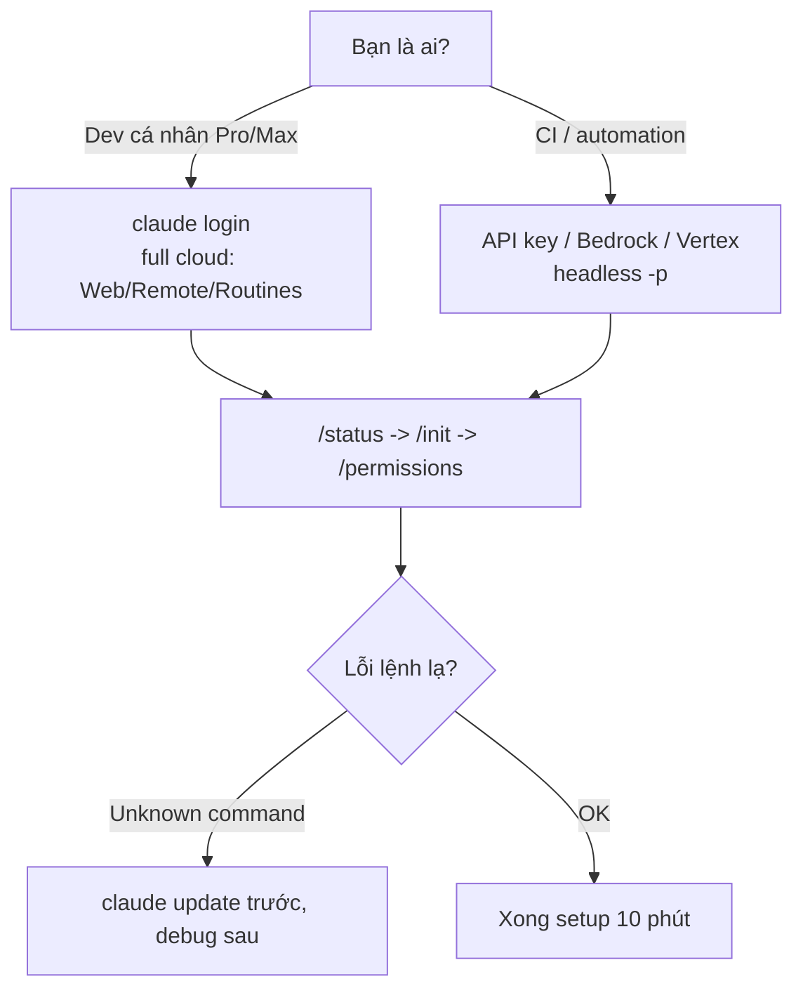

# FAQ 01 — Tài khoản, pricing & cài đặt

> **Bài này cho ai:** bạn cần trả lời 3 câu về Claude Code — cần tài khoản gì, tốn bao nhiêu, cài đặt sao cho sạch.
> **Cần gì trước:** mở được terminal; máy có `gh` CLI thì làm luôn bước `/web-setup`, không có thì bỏ qua.
> **Đọc xong bạn làm được:**
> - Chọn đúng đường vào (subscription hay API key), biết gói nào có Claude Code và giá từng gói.
> - Cài đúng 1 bản, dọn duplicate install bằng `which -a claude` + `claude doctor` (trong session: `/doctor`, alias `/checkup`).
> - Fix `Unknown command` theo thứ tự update trước, debug sau.
> **Thời gian:** ~10 phút

## Thuật ngữ dùng trong bài này

| Thuật ngữ | Hiểu nôm na là gì | Ví dụ thấy ngay |
|---|---|---|
| Subscription | Gói trả tiền tháng của claude.ai (Pro/Max/Team) — đăng nhập bằng tài khoản, không dán key | `claude login` → browser mở trang đăng nhập |
| API key | Chuỗi `sk-ant-...` của Anthropic Console, trả tiền theo tokens thật dùng | `export ANTHROPIC_API_KEY="sk-ant-xxxx"` |
| Provider | Nơi model chạy: Anthropic trực tiếp hay qua cloud khác (Bedrock, GCP, Foundry) | `/status` hiện provider đang dùng |
| Native binary | Bản cài chính chủ tải thẳng từ Anthropic, update bằng `claude update` | `curl -fsSL https://claude.ai/install.sh \| bash` |
| Version floor | Bản tối thiểu để lệnh tồn tại — bản cũ gõ vào là `Unknown command` | `/cd` cần ≥2.1.169 |

## Mục lục

- [Sơ đồ nhanh](#sơ-đồ-nhanh)
- [1. Cần tài khoản gì, gói nào có Claude Code?](#1-cần-tài-khoản-gì-gói-nào-có-claude-code)
- [2. Provider: Sub / Console / Bedrock / GCP / Foundry khác nhau gì?](#2-provider-sub--console--bedrock--gcp--foundry-khác-nhau-gì)
- [3. Web / Mobile / Routines / Remote vì sao bắt buộc claude.ai sign-in?](#3-web--mobile--routines--remote-vì-sao-bắt-buộc-claudeai-sign-in)
- [4. Cài thế nào cho sạch + dọn duplicate install?](#4-cài-thế-nào-cho-sạch--dọn-duplicate-install)
- [5. claude update và version floor: lệnh lạ 90% là version cũ](#5-claude-update-và-version-floor-lệnh-lạ-90-là-version-cũ)
- [6. Repo mới: 5 lệnh setup đầu + copy templates/CLAUDE.md](#6-repo-mới-5-lệnh-setup-đầu--copy-templatesclaudemd)
- [Vẫn lỗi thì sao? (thứ tự debug chuẩn)](#vẫn-lỗi-thì-sao-thứ-tự-debug-chuẩn)

---

## Sơ đồ nhanh



---

## 1. Cần tài khoản gì, gói nào có Claude Code?

> **Hỏi ngắn gọn:** cài Claude Code thì phải mua gói gì, hay tài khoản thường cũng dùng được?
>
> **Trả lời 1 câu:** Không bắt buộc mua gói — dùng tài khoản claude.ai (Pro/Max/Team/Enterprise) hoặc API key Anthropic Console; gói Free thì không có Claude Code.

**Giải thích:** Hai đường vào khác nhau ở cách trả tiền:

- **Subscription (Pro / Max / Team / Enterprise):** đăng nhập `claude.ai`, dùng chung quota subscription. Hợp dev cá nhân và team đã mua gói Claude.
- **API key (Anthropic Console):** `sk-ant-...` trả theo usage. Hợp CI, automation, team muốn tách bill theo key.

Terminal CLI + VS Code extension hỗ trợ thêm third-party providers: Bedrock, GCP Agent Platform (Vertex), Foundry.

Giá gói subscription (tra 11/10/2026, nguồn [WRITING-STYLE — Phần B](../WRITING-STYLE.md#phần-b--dữ-kiện-chuẩn-làm-tròn-thời-gian-11102026)):

| Gói | Giá /tháng | Claude Code? | Ghi chú |
|---|---|---|---|
| Free | $0 | ❌ | Không có Claude Code |
| Pro | $17 (trả trước năm) hoặc $20 | ✅ | Ít nhất 5× Free theo phiên 5 giờ |
| Max 5x / 20x | $100 / $200 | ✅ | 5× / 20× Pro theo phiên 5 giờ |
| Team (Standard) | $20 (trả trước năm) hoặc $25 | ✅ | Tối thiểu 2 ghế, tối đa 150 ghế |
| Team (Premium) | $100 (trả trước năm) hoặc $125 | ✅ | 5× Standard |

Hạn mức tính theo **phiên 5 giờ cuộn** + hạn tuần; chat web và Claude Code dùng chung 1 hạn mức. Riêng **Fable 5.1 không nằm trong hạn mức thường**: trên Pro nó bill bằng usage credits, trên Max tốn ~50% hạn tuần cho mỗi lượt dùng.

Trả theo API key thì giá theo model (USD / 1M tokens): **Fable 5.1** $10/$50 · **Opus 5.5** $4/$20 (mặc định tài khoản, cache đọc $0.20) · **Sonnet 5.5** $2/$10 · **Haiku 5.5** $0.10/$0.50 (1M context, cần ≥2.1.293) · **Haiku 4.5** $1/$5 với context 200K (mặc định Haiku trên Bedrock/GCP/AWS).

```bash
# Cách 1: subscription (khuyên dùng cho dev tay)
claude login        # → mở browser, sign-in claude.ai

# Cách 2: API key (khuyên dùng cho CI/máy phụ)
export ANTHROPIC_API_KEY="sk-ant-xxxx"
claude -p "ping" --output-format json
```

Có Pro cá nhân + công ty cấp Bedrock → máy dev `claude login` (Pro), CI dùng Bedrock creds — tách 2 môi trường, không lẫn bill.

**Đổi account:** ngoài terminal dùng `claude login` / `claude logout`; đang trong session dùng `/login` / `/logout` / `/status` (soi gương: account, provider, model, version) — khỏi thoát ra. Nghi bill sai account → `/status` → `/logout` → `/login` lại, không mất session.

**Đào sâu:** [Bài 01 — cài đặt và xác thực](../01-huong-dan-su-dung/01-cai-dat-va-xac-thuc.md) · [FAQ 10 — CI, SDK, routines, Web](10-ci-sdk-routines-web.md) · [lệnh `status`](../01-huong-dan-su-dung/commands/auth-settings/status/README.md)

---

## 2. Provider: Sub / Console / Bedrock / GCP / Foundry khác nhau gì?

> **Hỏi ngắn gọn:** bên mình chạy AWS hay GCP, Claude Code dùng được không và thiếu gì so với trả thẳng Anthropic?
>
> **Trả lời 1 câu:** Xài được — mọi provider đều chạy đủ terminal + IDE, nhưng chỉ subscription claude.ai mới có Web/Routines/Remote.

| Tính năng | Sub (claude.ai) | Console API | Bedrock | GCP/Vertex | Foundry |
|---|---|---|---|---|---|
| Terminal + IDE cơ bản | ✅ | ✅ | ✅ | ✅ | ✅ (giới hạn) |
| Web / Mobile / Desktop-cloud | ✅ | ❌ (cần sign-in) | ❌ | ❌ | ❌ |
| Slack / Chrome ext / Computer use / Artifacts | ✅ | ❌ | ❌ | ❌ | ❌ |
| Routines (`/schedule`) | ✅ | ❌ | ❌ | ❌ | ❌ |
| Remote (`--cloud`, teleport) | ✅ | ❌ | ❌ | ❌ | ❌ |
| CI `-p` headless | ✅ | ✅ | ✅ | ✅ | ❌ |
| ZDR (zero retention) | Enterprise qualified | Qualified accounts | Mặc định tắt gửi về Anthropic* | Mặc định tắt* | Theo MS contract |
| Telemetry gửi về Anthropic | Theo cài đặt | Theo cài đặt | Tắt mặc định | Tắt mặc định | Theo MS |

\* Xem provider docs của bạn để xác nhận; hỏi admin/contract trước khi cam kết với khách (chi tiết [FAQ 09](09-bao-mat-quyen-rieng-tu.md)).

```bash
/status    # dòng Provider hiện Bedrock / GCP / Anthropic — đừng đoán
```

Team enterprise chọn Bedrock/GCP vì compliance → chấp nhận mất Routines/Remote. Dev indie chọn Sub → full tính năng cloud.

**Đào sâu:** [Bài 02 — từng bề mặt dùng](../01-huong-dan-su-dung/02-cac-be-mat-terminal-ide-web-desktop.md) · [FAQ 09 — bảo mật & riêng tư](09-bao-mat-quyen-rieng-tu.md)

---

## 3. Web / Mobile / Routines / Remote vì sao bắt buộc claude.ai sign-in?

> **Hỏi ngắn gọn:** mình có API key rồi mà sao mở Web hay gõ `/schedule` vẫn bảo phải đăng nhập?
>
> **Trả lời 1 câu:** Vì đó là cloud service của Anthropic — muốn dùng phải đăng nhập `claude.ai`, API key không đủ.

Các mặt Web / Mobile / Desktop-cloud / Slack / Chrome extension / Computer use / Artifacts / Routines (`/schedule`) / Remote (`--cloud`, teleport) chạy trên hạ tầng cloud của Anthropic (session persist cross-device, push branch, schedule...), nên phải gắn với identity `claude.ai`. API-key-only = cục model trần, thiếu lớp "session cloud". 99% trường hợp "sao không thấy nút cloud" là đang dùng API-key-only.

```bash
claude login        # đảm bảo đã sign-in claude.ai
/status             # xem account hiện tại
/web-setup          # sync token + tạo cloud environment (cần gh CLI)
/teleport           # thử chuyển session lên cloud
```

**Đào sâu:** [FAQ 10 — routines, Web, CI](10-ci-sdk-routines-web.md) · [Bài 02 — terminal/IDE/web/desktop](../01-huong-dan-su-dung/02-cac-be-mat-terminal-ide-web-desktop.md)

---

## 4. Cài thế nào cho sạch + dọn duplicate install?

> **Hỏi ngắn gọn:** nên cài Claude Code bằng cách nào, update hoài mà lệnh mới vẫn `Unknown command` thì kiểm tra kiểu gì?
>
> **Trả lời 1 câu:** Chỉ giữ **1** bản native binary; máy có 2 bản song song thì `which -a claude` sẽ soi ra — gỡ bản npm/brew thừa.

3 đường cài, chỉ nên giữ đường 1:

- **Native binary (khuyên dùng):** `curl .../install.sh | bash` — binary chính chủ, update nhanh, ít lỗi PATH nhất.
- **Homebrew cask:** tiện cho macOS, nhưng version có thể chậm hơn native nửa nhịp.
- **npm:** chỉ khi kẹt môi trường không cài được binary (container lạ). Dễ dính duplicate nhất.

Triệu chứng duplicate: `which -a claude` ra 2 đường, `/status` báo version khác `claude --version`, update hoài không lên.

```bash
# Cài native:
curl -fsSL https://claude.ai/install.sh | bash
claude --version

# Soi + dọn duplicate:
which -a claude
npm ls -g @anthropic-ai/claude-code 2>/dev/null
claude doctor   # phát hiện duplicate install, settings parse lỗi, PATH lỗi

# Dọn: giữ native, gỡ npm
npm uninstall -g @anthropic-ai/claude-code
hash -r
which claude    # giờ chỉ còn 1
claude update
```

`which -a` ra `/opt/homebrew/bin/claude` + `~/.nvm/.../claude` → gỡ bản npm, giữ brew/native, PATH sạch lại.

**Đào sâu:** [Bài 01 — cài đặt và xác thực](../01-huong-dan-su-dung/01-cai-dat-va-xac-thuc.md) · [lệnh `doctor`](../01-huong-dan-su-dung/commands/knowledge-system/doctor/README.md)

---

## 5. claude update và version floor: lệnh lạ 90% là version cũ

> **Hỏi ngắn gọn:** gõ `/cd` mà bị trả `Unknown command` thì phải làm sao?
>
> **Trả lời 1 câu:** Đừng cài thêm — chạy `claude update` rồi mở session mới: 90% "lệnh lạ" là do bản cũ.

Quy tắc: **update trước, debug sau**. Bản mới nhất tại thời điểm viết: **v2.1.296** (09/10/2026). Bảng version floor hay gặp:

| Lệnh / tính năng | Cần bản tối thiểu | Ghi chú |
|---|---|---|
| `/goal` | ≥2.1.139 | Đặt mục tiêu session |
| `/verify` | ≥2.1.145 | Chạy app thật |
| `/cd` | ≥2.1.169 | Đổi working dir trong session |
| `/skill-doctor` | ≥2.1.252 | Tìm skill không dùng |
| `fable` → Fable 5.1 | ≥2.1.257 | Mạnh nhất, chậm nhất; trên Pro bill usage credits, trên Max ~50% hạn tuần |
| Opus 5.5 (mặc định tài khoản) | ≥2.1.280 | Mặc định trên Pro/Max/Team/Enterprise/API/Bedrock/GCP |
| Sonnet 5.5 | ≥2.1.284 | Mặc định Sonnet trên API |
| Haiku 5.5 | ≥2.1.293 | Mặc định Haiku trên API; 1M context |

```bash
claude update
claude --version
/status    # xem version đang chạy
```

Gõ `/cd web` → `Unknown command: /cd` → `claude update` lên ≥2.1.169, mở session mới, gõ lại → chạy.

**Đào sâu:** [Bài 04 — slash commands toàn tập](../01-huong-dan-su-dung/04-slash-commands-toan-tap.md) · [WRITING-STYLE — B6 lệnh theo bản](../WRITING-STYLE.md#phần-b--dữ-kiện-chuẩn-làm-tròn-thời-gian-11102026) · [FAQ 08 — lỗi thường gặp](08-loi-thuong-gap-troubleshooting.md)

---

## 6. Repo mới: 5 lệnh setup đầu + copy templates/CLAUDE.md

> **Hỏi ngắn gọn:** vừa clone repo về, gõ `claude` xong thì làm gì tiếp, repo trống thì sao?
>
> **Trả lời 1 câu:** Có code → `/init` quét thật; repo trống → copy `templates/CLAUDE.md` rồi sửa. Cả 2 đều kết thúc bằng chuỗi `/memory` → `/mcp` → `/permissions`.

5 bước theo đúng thứ tự:

1. `/init` — sinh CLAUDE.md từ codebase thật (repo trống thì `/init` chỉ sinh file chung chung → copy template theo stack rồi sửa 20%).
2. `/memory` — tách sở thích cá nhân ra khỏi CLAUDE.md.
3. `/mcp` — gắn data ngoài repo (DB, tickets, docs...). Không có thì bỏ qua.
4. Tạo subagents — tách việc đọc ồn sang worker (xem [FAQ 07](07-subagents-teams-workflows.md)).
5. `/permissions` — dựng phanh allow/ask/deny baseline (xem [FAQ 03](03-permissions-modes.md)).

```bash
cd ~/code/my-repo && claude

# Repo trống:
ls templates/
cp templates/CLAUDE.md ./CLAUDE.md
# Mở CLAUDE.md, sửa: stack, lệnh test/lint/build, cấu trúc thư mục

# Trong session, theo thứ tự:
/init
/memory
/mcp
/permissions
/doctor   # khám lại xem còn đỏ gì
```

Template Node ghi `npm test`; bạn dùng `pnpm` → sửa ngay dòng đó. Sau khi code lên hình (vài trăm dòng), chạy `/init` lại để bổ sung kiến trúc thật. Team thì commit `.claude/` + `CLAUDE.md` để người sau khỏi setup lại.

**Đào sâu:** [Bài 03 — CLAUDE.md & memory](../01-huong-dan-su-dung/03-claude-md-memory-rules.md) · [FAQ 03 — permissions & modes](03-permissions-modes.md) · [FAQ 07 — subagents & teams](07-subagents-teams-workflows.md) · [templates/](../templates/)

---

## Vẫn lỗi thì sao? (thứ tự debug chuẩn)

1. `/status` — xem version + account + provider (cũ → `claude update`).
2. `claude doctor` — duplicate install, settings parse lỗi, PATH lỗi.
3. `/permissions` — xem merged rules (lỗi lạ có thể do deny ẩn).
4. `/debug` — chẩn đoán session hiện tại.
5. `/bug` — gói report gửi Anthropic (kèm `/status` + `claude doctor`).

```bash
claude update && claude doctor
```

**Tham khảo chéo:** [lệnh `status`](../01-huong-dan-su-dung/commands/auth-settings/status/README.md) · [lệnh `doctor`](../01-huong-dan-su-dung/commands/knowledge-system/doctor/README.md) · [lệnh `init`](../01-huong-dan-su-dung/commands/code-repo/init/README.md) · [FAQ 08 — bảng lỗi full](08-loi-thuong-gap-troubleshooting.md) · [FAQ 02 — model & token](02-model-context-token.md)

> Mẹo 1 dòng: _update trước debug sau, giữ đúng 1 bản cài, và 5 lệnh đầu repo là init → memory → mcp → subagents → permissions._
