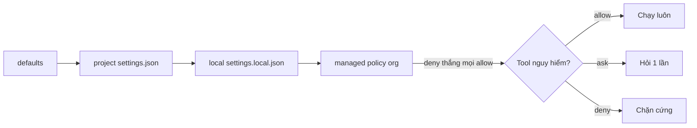

# FAQ 03 — Permissions & modes (quyền hạn, chế độ & headless)

> **Bài này cho ai:** bạn cần dựng phanh cho Claude Code, chọn permission mode đúng việc, hoặc đang kẹt deny lúc headless mà không hiểu vì sao.
> **Cần gì trước:** đã cài và đăng nhập Claude Code ([FAQ 01](01-tai-khoan-pricing-cai-dat.md)); đọc qua [bài 10 — permissions & modes](../01-huong-dan-su-dung/10-permissions-modes-availability.md) càng tốt, không bắt buộc.
> **Đọc xong bạn làm được:**
> - Dựng phanh 3 lớp allow / ask / deny ở đúng file settings và xem bản merged bằng `/permissions`.
> - Xoay 5 permission mode bằng Shift+Tab, biết lúc nào giữ `plan`, lúc nào nới `auto`, khi nào `bypassPermissions` hợp lệ.
> - Chạy headless `-p` với allowlist không bị kẹt deny, viết `PreToolUse` hook deny thắng cả `bypassPermissions`.
> **Thời gian:** ~15 phút

## Thuật ngữ dùng trong bài này

| Thuật ngữ | Hiểu nôm na là gì | Ví dụ thấy ngay |
|---|---|---|
| Permission | Quyền Claude được tự làm việc gì mà không phải hỏi bạn | `/permissions` hiện bảng allow/ask/deny |
| allow / ask / deny | 3 mức: tự chạy luôn / hỏi 1 câu rồi chạy / cấm hẳn | `"deny": ["Bash(rm -rf:*)"]` trong settings.json |
| Permission mode | Mức "tin tưởng" của cả session, xoay bằng Shift+Tab | `plan` chỉ đọc, `bypassPermissions` bỏ hết câu hỏi |
| Headless | Chế độ `-p` cho CI/scripts: không ai bấm Yes → mọi `ask` thành deny | `claude -p "review PR"` |

## Mục lục

- [Sơ đồ nhanh](#sơ-đồ-nhanh)
- [Bảng tổng hợp: allow / ask / deny + 3 files + 5 modes](#bảng-tổng-hợp-allow--ask--deny--3-files--5-modes)
- [1. allow / ask / deny viết ở đâu?](#1-allow--ask--deny-viết-ở-đâu)
- [2. Shift+Tab xoay modes thế nào? `auto` giờ mặc định ra sao?](#2-shifttab-xoay-modes-thế-nào-auto-giờ-mặc-định-ra-sao)
- [3. Hook vs permission rule — ai thắng?](#3-hook-vs-permission-rule--ai-thắng)
- [4. Rules có chặn được lệnh lách không?](#4-rules-có-chặn-được-lệnh-lách-không)
- [5. Headless `-p` bị deny hàng loạt — fix + allowlist thế nào?](#5-headless--p-bị-deny-hàng-loạt--fix--allowlist-thế-nào)
- [6. 3 settings files merge thế nào?](#6-3-settings-files-merge-thế-nào)
- [7. Khi nào dùng `--dangerously-skip-permissions`?](#7-khi-nào-dùng---dangerously-skip-permissions)
- [Vẫn lỗi thì sao? (permissions/modes)](#vẫn-lỗi-thì-sao-permissionsmodes)

---

## Sơ đồ nhanh



## Bảng tổng hợp: allow / ask / deny + 3 files + 5 modes

| Khái niệm | Tóm tắt 1 dòng | Xem ở đâu |
|---|---|---|
| `allow` | Được chạy luôn, không hỏi | `/permissions` |
| `ask` | Hỏi từng lần (mặc định cho sửa/xoá/chạy) | `/permissions` |
| `deny` | Cấm luôn, hook allow cũng không nới được | `/permissions` merged |
| `.claude/settings.json` | Share team, commit git | Team baseline |
| `.claude/settings.local.json` | Cá nhân, không commit | Sở thích + allowlist riêng |
| Managed policy (org) | Admin ép, thắng mọi cái local | Team/Enterprise |
| `default` / `acceptEdits` | Hỏi như thường / tự sửa file, lệnh vẫn hỏi | Shift+Tab |
| `plan` | Chỉ đọc + trình plan, không sửa | Task lớn, duyệt trước |
| `auto` | Classifier duyệt quyền thay bạn — mặc định session mới trên Pro/Max/Team từ 14/08/2026 | Task tin cậy |
| `bypassPermissions` | Bỏ hỏi (chỉ CI sandbox) | Không dùng máy dev |

Thứ tự merge (thắng dần): **defaults < project < local < managed**. Managed deny mà local allow → allow vô ích.

---

## 1. allow / ask / deny viết ở đâu?

> **Hỏi ngắn gọn:** muốn cấm Claude chạy `rm -rf`, hay cho nó tự chạy test không cần hỏi, thì ghi rule vào đâu?
>
> **Trả lời 1 câu:** Ghi vào 3 chỗ (2 settings file + managed policy của org) rồi mở `/permissions` xem bản merged — đừng đoán file nào đang thắng.

- `.claude/settings.json` — team baseline, commit git (VD: deny `rm -rf`, deny `.env`).
- `.claude/settings.local.json` — cá nhân, không commit (VD: allow thêm `pnpm`).
- Managed policy — org ép từ xa (VD: cấm `curl ... | bash`), local không gỡ được.

```json
{
  "permissions": {
    "allow": ["Read", "Glob", "Grep", "Bash(npm test:*)", "Bash(npm run lint:*)", "Bash(git status:*)", "Bash(git diff:*)"],
    "ask": ["Edit", "Write", "Bash(npm install:*)", "Bash(git push:*)"],
    "deny": ["Bash(rm -rf:*)", "Bash(sudo:*)", "Read(.env)", "Read(.env.*)", "Bash(curl * | bash:*)"]
  }
}
```

PR nào xóa mất rule `deny rm -rf` khỏi `.claude/settings.json` → `/doctor` (mục permissions) báo đỏ, CI của team chặn merge (setup 5 lệnh đầu repo xem [FAQ 01 câu 6](01-tai-khoan-pricing-cai-dat.md#6-repo-mới-5-lệnh-setup-đầu--copy-templatesclaudemd)).

**Đào sâu:** [lệnh `/permissions`](../01-huong-dan-su-dung/commands/model-mode/permissions/README.md) · [câu 6 — merge thế nào](#6-3-settings-files-merge-thế-nào)

---

## 2. Shift+Tab xoay modes thế nào? `auto` giờ mặc định ra sao?

> **Hỏi ngắn gọn:** bấm Shift+Tab thấy hiện plan rồi acceptEdits — mấy chế độ đó là gì, sao session mới mở đã ở mode `auto`?
>
> **Trả lời 1 câu:** Shift+Tab xoay vòng 5 permission mode; **từ 14/08/2026, `auto` là mode mặc định cho session mới trên Pro/Max/Team** — classifier server-side duyệt quyền thay bạn, nằm giữa "hỏi từng bước" và bỏ hết câu hỏi.

```text
default ── hỏi như thường (làm task lạ)
acceptEdits ── tự sửa file, lệnh nguy hiểm vẫn hỏi (refactor nhiều file)
plan ── chỉ đọc + trình plan, KHÔNG sửa (task lớn, muốn duyệt trước)
auto ── classifier duyệt quyền thay bạn (mặc định session mới Pro/Max/Team từ 14/08/2026)
bypassPermissions ── bỏ hỏi TẤT CẢ (CHỈ CI sandbox, KHÔNG máy dev)
```

`auto` chặn cứng destructive git và `rm -rf` trên biến chưa resolve, có hard deny rules; thấy nó từ chối việc hợp lệ thì mở `/permissions` xem deny ẩn hoặc đổi mode bằng Shift+Tab.

Gõ `/plan` cũng vào được plan mode. Task "refactor auth 20 files" → vào `plan` trước, duyệt plan 5 phút, rồi sang `acceptEdits` cho chạy. Đừng vào `acceptEdits` ngay với task chưa hiểu.

Riêng cloud session: chỉ có `acceptEdits` / `plan` (`auto` tùy bản), **không có `bypassPermissions`** — cloud chạy xa tay bạn, bypass là tự sát. Script CI/cloud định dùng `--permission-mode bypassPermissions` → đổi sang `dontAsk` + allowlist rõ ([FAQ 10](10-ci-sdk-routines-web.md)).

**Đào sâu:** [lệnh `/plan`](../01-huong-dan-su-dung/commands/model-mode/plan/README.md) · [bài 10 — permissions & modes theo provider](../01-huong-dan-su-dung/10-permissions-modes-availability.md)

---

## 3. Hook vs permission rule — ai thắng?

> **Hỏi ngắn gọn:** mình viết hook deny mà permission lại allow — cái nào mới chặn được Claude thật sự?
>
> **Trả lời 1 câu:** Hook `PreToolUse` deny thắng mọi thứ kể cả `bypassPermissions`; ngược lại hook allow không nới được gì cả.

- **`PreToolUse` hook deny THẮNG TẤT CẢ**, kể cả `bypassPermissions` — hook là phanh tay độc lập.
- **Hook allow KHÔNG nới được** deny của settings hay `ask` của org. Hooks chỉ siết thêm.
| Cặp đấu | Ai thắng? |
|---|---|
| Hook deny vs `bypassPermissions` | Hook deny thắng |
| Hook allow vs settings deny | Settings deny thắng (allow vô ích) |
| Managed deny vs local allow | Managed thắng |
| Permission allow vs `ask` mặc định | Allow thắng (trong cùng level) |

Việc critical (push main, xóa DB) → hook deny + settings deny cả hai:

```bash
# scripts/guard-no-push-main.sh — chặn push main dù bypass
#!/bin/bash
input=$(cat)
echo "$input" | grep -q '"command": *"git push.*main' && echo '{"decision":"block","reason":"Cấm push main"}' && exit 0
echo '{"decision":"approve"}'
```

```json
{ "hooks": { "PreToolUse": [{ "matcher": "Bash", "hooks": [{ "type": "command", "command": "./scripts/guard-no-push-main.sh" }] }] } }
```

**Đào sâu:** [FAQ 05 — hooks](05-hooks-faq.md) · [bài 07 — hooks tự động hóa](../01-huong-dan-su-dung/07-hooks-tu-dong-hoa.md)

---

## 4. Rules có chặn được lệnh lách không?

> **Hỏi ngắn gọn:** mình đã deny `rm -rf` rồi — model có chạy được lệnh tương tự mà vẫn lọt qua rule không?
>
> **Trả lời 1 câu:** Không chắc chắn — rule permission chỉ match chuỗi lệnh, không phải bộ phân tích bảo mật của shell.

```text
deny "Bash(rm -rf:*)"  →  lách bằng `rm -R -f`, `python -c 'shutil.rmtree(...)'`, `./my-rm.sh`
deny "Read(.env)"      →  lách bằng `cat .env` qua Bash, `cp .env /tmp/x`
```

Rule chặn "người ngay"; chặn "kẻ gian" (lách cố ý) → hook kiểm tra sâu + OS sandbox (container không sudo, secrets mount read-only) song song với rules.

**Đào sâu:** [lệnh `sandbox`](../01-huong-dan-su-dung/commands/auth-settings/sandbox/README.md) · [FAQ 09 — bảo mật & riêng tư](09-bao-mat-quyen-rieng-tu.md)

---

## 5. Headless `-p` bị deny hàng loạt — fix + allowlist thế nào?

> **Hỏi ngắn gọn:** chạy `claude -p` trên CI thấy subagent nào cũng bị deny, viết allowlist sao cho không kẹt giữa chừng?
>
> **Trả lời 1 câu:** `-p` không hiện prompt → mọi `ask` thành deny; fix bằng allowlist hẹp đúng việc script cần — đừng `allow Bash(*)` cho gọn, đó là mở toang.

```bash
# CI review an toàn: pre-approve read-only + lệnh hẹp, mode dontAsk
claude -p "review diff" \
  --permission-mode dontAsk \
  --allowedTools "Read Grep Glob Bash(git diff:*) Bash(git log:*) Bash(npm test:*)" \
  --output-format json

# Background subagent research (read-only tuyệt đối):
claude -p "quét auth flow" \
  --permission-mode dontAsk \
  --allowedTools "Read Grep Glob" \
  --output-format json
```

Background agent cần `git push` → headless deny (vì `ask`). Fix: hoặc allow rõ `Bash(git push origin feat/*:*)`, hoặc tách bước push cho người bấm tay. Luôn chạy tay 1 lần với đúng allowlist trước khi gắn vào cron/CI.

**Đào sâu:** [FAQ 10 — CI, SDK, routines, Web](10-ci-sdk-routines-web.md) · [FAQ 08 — lỗi thường gặp](08-loi-thuong-gap-troubleshooting.md)

---

## 6. 3 settings files merge thế nào?

> **Hỏi ngắn gọn:** đã allow rồi mà sao nó vẫn hỏi / vẫn deny — có phải rule ở chỗ khác thắng không?
>
> **Trả lời 1 câu:** Có — merge theo thứ tự defaults → project → local → managed, cùng key thì file đứng sau thắng, nhưng managed deny / org `ask` luôn thắng local allow.

Bản merged mới là thứ chạy thật — xem nó tại `/permissions`, đừng mở từng file đoán.

```bash
/permissions    # XEM MERGED TẠI ĐÂY, đừng mở từng file đoán
cat .claude/settings.json
cat .claude/settings.local.json 2>/dev/null
```

Local bạn `allow Bash(curl:*)` nhưng managed deny → `/permissions` hiện deny → đừng mất 30 phút debug "sao allow rồi vẫn hỏi". Hỏi admin org.

**Đào sâu:** [lệnh `/permissions`](../01-huong-dan-su-dung/commands/model-mode/permissions/README.md) · [FAQ 09 — bảo mật & riêng tư](09-bao-mat-quyen-rieng-tu.md)

---

## 7. Khi nào dùng `--dangerously-skip-permissions`?

> **Hỏi ngắn gọn:** có lúc nào an toàn khi chạy `--dangerously-skip-permissions` trên máy mình không?
>
> **Trả lời 1 câu:** Gần như không — chỉ CI sandbox cô lập: container dùng 1 lần, không secrets thật, không network ra ngoài.

Hook deny vẫn thắng flag này, nhưng permission hỏi thì bỏ hết — 1 lệnh `rm -rf` ngáo là đi cả máy. Mỗi khi định thêm flag vào script local hay docker dev thường trực → đó là dấu hiệu cần viết allowlist (xem [câu 5](#5-headless--p-bị-deny-hàng-loạt--fix--allowlist-thế-nào)).

```bash
# ✅ CI sandbox dùng 1 lần:
claude -p "migrate test" --dangerously-skip-permissions

# ❌ Máy dev / cloud session: KHÔNG BAO GIỜ
```

Mở 1 session "sạch" để soi nghi vấn (mods/hooks ngoài không load) → dùng `claude --safe-mode`; chạy ở chế độ giới hạn thêm → `--restricted`.

**Đào sâu:** [FAQ 09 — bảo mật & riêng tư](09-bao-mat-quyen-rieng-tu.md) · [bài 10 — permissions & modes theo provider](../01-huong-dan-su-dung/10-permissions-modes-availability.md)

---

## Vẫn lỗi thì sao? (permissions/modes)

1. `/permissions` — xem merged rules (deny ẩn? managed thắng?).
2. `/hooks` — có hook deny nào chặn không (hook thắng bypass).
3. `claude doctor` + `/status` — version cũ? duplicate install? mode `auto` có tùy bản/provider.
4. Trust dialog — frontmatter hooks project cần trust folder (xem [FAQ 05 câu 2](05-hooks-faq.md#2-folder-đã-trust-chưa)).
5. `/debug` — session vẫn lạ → chẩn đoán sâu; `/bug` kèm `/status` + `claude doctor`.

```bash
/permissions
/hooks
/debug
```

**Tham khảo chéo:** [lệnh `/permissions`](../01-huong-dan-su-dung/commands/model-mode/permissions/README.md) · [lệnh `/hooks`](../01-huong-dan-su-dung/commands/knowledge-system/hooks/README.md) · [FAQ 05](05-hooks-faq.md) (hook vs rule) · [FAQ 09](09-bao-mat-quyen-rieng-tu.md) (bảo mật) · [FAQ 10](10-ci-sdk-routines-web.md) (CI headless)

> Mẹo 1 dòng: _merged xem ở /permissions, hook deny thắng bypass, và bypass chỉ sống trong CI sandbox._
