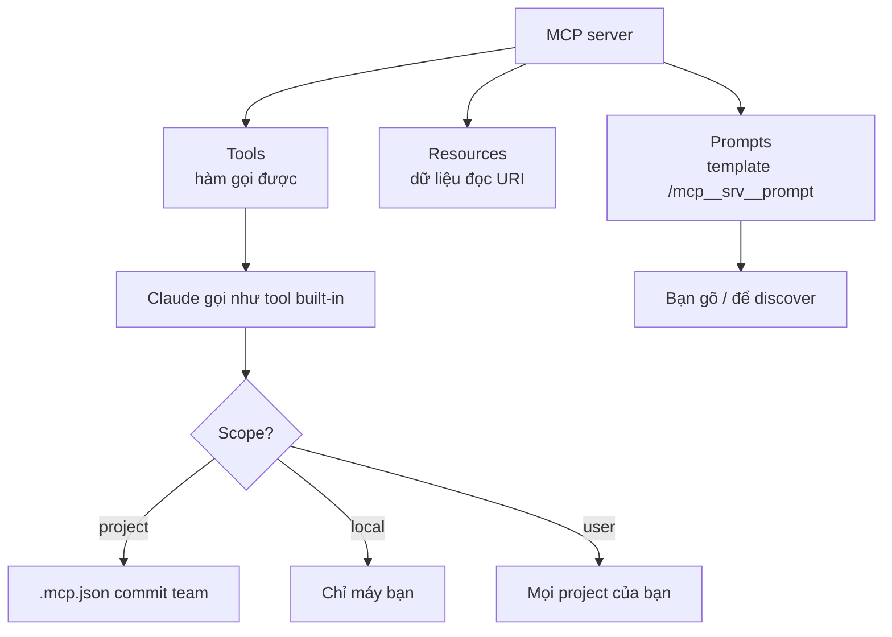

# FAQ 04 — MCP: kết nối & sự cố

> **Bài này cho ai:** bạn muốn cắm thêm công cụ ngoài (database, GitHub, tickets, browser) cho Claude Code, hoặc server MCP đang chết mà chưa biết check gì trước.
> **Cần gì trước:** đã cài và đăng nhập Claude Code ([FAQ 01](01-tai-khoan-pricing-cai-dat.md)); đọc [bài 08 — kết nối công cụ ngoài](../01-huong-dan-su-dung/08-mcp-ket-noi-cong-cu-ngoai.md) càng tốt, không bắt buộc.
> **Đọc xong bạn làm được:**
> - Thêm server đúng ngay lần đầu: chọn transport (stdio/sse/http) và scope (project/local/user) hợp với việc cần làm.
> - Giấu token trong `.mcp.json` bằng `${VAR}` và check bằng `git grep` trước khi commit.
> - Sửa server disconnected theo đúng thứ tự token → URL → OAuth (dùng được `claude mcp login/logout`), reconnect sau sleep.
> **Thời gian:** ~12 phút

## Thuật ngữ dùng trong bài này

| Thuật ngữ | Hiểu nôm na là gì | Ví dụ thấy ngay |
|---|---|---|
| MCP (Model Context Protocol) | Chuẩn kết nối chung để tool ngoài nói chuyện được với AI | `claude mcp add --transport stdio github -- npx ...` |
| Transport | Loại "dây nối": `stdio` server chạy trên máy bạn, `sse`/`http` server ở xa qua URL | `--transport stdio` vs `--transport http` |
| Scope | Nơi server được ghi nhớ: project (commit git), local (chỉ máy bạn), user (mọi project) | `claude mcp add --scope local ...` |
| Tools / Resources / Prompts | 3 thứ server phơi ra: hàm gọi được, dữ liệu đọc theo URI, mẫu việc | `/mcp` hiện tools count; gõ `/` thấy `mcp__...` |

## Mục lục

- [Sơ đồ nhanh](#sơ-đồ-nhanh)
- [Bảng tổng hợp: vòng đời 1 MCP server](#bảng-tổng-hợp-vòng-đời-1-mcp-server)
- [1. Thêm server thế nào? (transport + scope + secrets)](#1-thêm-server-thế-nào-transport--scope--secrets)
- [2. Tools / Resources / Prompts khác nhau gì?](#2-tools--resources--prompts-khác-nhau-gì)
- [3. Xem / sửa connections (`/mcp`, `reconnect`, CLI, `claude mcp login`)](#3-xem--sửa-connections)
- [4. Server disconnected — check gì?](#4-server-disconnected--check-gì)
- [5. Khi nào cần MCP vs đọc repo trực tiếp? Bao nhiêu server là đủ?](#5-khi-nào-cần-mcp-vs-đọc-repo-trực-tiếp-bao-nhiêu-server-là-đủ)
- [6. Lên cloud mất MCP local — xử lý sao?](#6-lên-cloud-mất-mcp-local--xử-lý-sao)
- [7. Skill vs MCP — khi nào viết skill kèm?](#7-skill-vs-mcp--khi-nào-viết-skill-kèm)
- [Vẫn lỗi thì sao? (MCP)](#vẫn-lỗi-thì-sao-mcp)

---

## Sơ đồ nhanh



## Bảng tổng hợp: vòng đời 1 MCP server

| Bước | Lệnh | Ghi chú |
|---|---|---|
| Add (stdio/sse/http) | `claude mcp add --transport <t> <name> ...` | Chọn scope project/local/user |
| List / xem | `/mcp` | Xem tools count + trạng thái |
| Reconnect | `/mcp reconnect <name>` | Token hết hạn, sleep dậy, OAuth |
| Enable / disable | `/mcp enable\|disable [name\|all]` | Server ít dùng thì disable |
| Login/logout OAuth | `claude mcp login <name>` / `claude mcp logout <name>` | Đăng nhập server OAuth từ terminal |
| CLI quản lý | `claude mcp list\|get\|remove\|reset-project-choices` | Dọn approvals cũ |
| Secrets | env vars `${TOKEN}`, không commit | Đỏ nếu hardcode token |
| Cloud | Cấu hình lại servers/vars/setup trong environment | Local không tự lên cloud |

---

## 1. Thêm server thế nào? (transport + scope + secrets)

> **Hỏi ngắn gọn:** thêm MCP server thì gõ lệnh gì, chọn stdio hay http, scope nào, token để đâu?
>
> **Trả lời 1 câu:** `claude mcp add --transport <stdio|sse|http> <tên> ...` — stdio cho server chạy trên máy bạn, http/sse cho server ở xa; scope quyết định ai thấy (`project` commit `.mcp.json`, `local`/`user` chỉ mình bạn); token luôn qua `${VAR}`.

Từ Claude Code **≥2.1.292** (06/10/2026), MCP mặc định negotiate protocol `2026-07-28` — áp cho cả connector claude.ai lẫn MCP local stdio/remote; muốn quay về cách cũ thì đặt `MCP_PROTOCOL_NEGOTIATION=legacy`.

3 scopes — chọn sai scope là cách nhanh nhất để lọt token:

| Scope | Lưu ở đâu | Ai thấy | Khi nào dùng |
|---|---|---|---|
| `--scope project` | `.mcp.json` (commit git) | Cả team | Server team dùng chung; secrets qua `${VAR}` |
| `--scope local` | máy bạn (không commit) | Chỉ bạn | Token cá nhân, thử nghiệm |
| `--scope user` | `~/.claude/` | Mọi project của bạn | Server cá nhân đa project |

```bash
# stdio (chạy local):
claude mcp add --transport stdio github -- npx -y @modelcontextprotocol/server-github
# http remote (SaaS) + scope project cho team:
claude mcp add --scope project --transport http linear --url https://mcp.linear.app/mcp --headers "Authorization: Bearer ${LINEAR_TOKEN}"
```

Secrets: `.mcp.json` được commit git → token phải nằm ở env `${VAR}`, không ghi thẳng vào file (hardcode = `claude doctor` báo đỏ):

```json
{
  "mcpServers": {
    "github": { "command": "npx", "args": ["-y", "@modelcontextprotocol/server-github"], "env": { "GITHUB_TOKEN": "${GITHUB_TOKEN}" } },
    "linear": { "transport": "http", "url": "https://mcp.linear.app/mcp", "headers": { "Authorization": "Bearer ${LINEAR_TOKEN}" } }
  }
}
```

```bash
export GITHUB_TOKEN="ghp_xxx"
claude mcp list   # check connected
git grep -E 'ghp_|sk-ant_|lin_' -- .mcp.json   # phải RỖNG
```

Onboard member mới → họ chỉ cần `export 2 VAR` là chạy; đổi token → đổi env, không sửa file.

**Đào sâu:** [bài 08 — transports & scope precedence](../01-huong-dan-su-dung/08-mcp-ket-noi-cong-cu-ngoai.md) · [FAQ 09 — bảo mật & riêng tư](09-bao-mat-quyen-rieng-tu.md)

---

## 2. Tools / Resources / Prompts khác nhau gì?

> **Hỏi ngắn gọn:** Tools / Resources / Prompts nghe giống nhau — khác nhau chỗ nào?
>
> **Trả lời 1 câu:** Tools là hàm gọi được, Resources là dữ liệu đọc theo URI, Prompts là template hiện thành lệnh `/mcp__...` — cả 3 do 1 server phơi ra.

| Thành phần | Là gì | Ví dụ | Thấy ở đâu |
|---|---|---|---|
| **Tools** | Hàm Claude gọi được (input/output schema) | `github.create_pr(...)` · `postgres.query("SELECT ...")` | `/mcp` hiện tools count; Claude tự gọi |
| **Resources** | Dữ liệu chỉ-đọc, địa chỉ URI | `github://repos/acme/api/issues/123` | Claude đọc như file |
| **Prompts** | Template việc chuẩn, hiện thành slash command động | `/mcp__github__review_pr` | Gõ `/` trong session để discover |

**Đào sâu:** [bài 08 — kết nối công cụ ngoài](../01-huong-dan-su-dung/08-mcp-ket-noi-cong-cu-ngoai.md) · [lệnh `/mcp`](../01-huong-dan-su-dung/commands/knowledge-system/mcp/README.md)

---

## 3. Xem / sửa connections

> **Hỏi ngắn gọn:** muốn xem server nào đang sống, nối lại, đăng nhập OAuth, hoặc tắt/bật thì gõ gì?
>
> **Trả lời 1 câu:** Trong session thì `/mcp` kèm `reconnect` / `enable` / `disable`; ngoài terminal thì `claude mcp list|get|remove|login|logout|reset-project-choices`.

```bash
# Trong session:
/mcp                        # list + trạng thái + tools count
/mcp reconnect github       # nối lại 1 server
/mcp disable playwright     # tắt server nặng khi không cần
/mcp enable playwright      # bật lại

# CLI (ngoài session):
claude mcp list
claude mcp get github
claude mcp login linear     # đăng nhập OAuth server từ terminal (≥ Week 26/2026)
claude mcp logout linear
claude mcp remove old-server
claude mcp reset-project-choices   # xóa approvals project cũ khi đổi policy
```

Lưu ý version: `-p` headless cần ≥2.1.205 mới có `/mcp` no-arg in text; cũ hơn thì dùng CLI `claude mcp list`.

**Đào sâu:** [lệnh `/mcp`](../01-huong-dan-su-dung/commands/knowledge-system/mcp/README.md) · [lệnh `/usage`](../01-huong-dan-su-dung/commands/session-context/usage/README.md) (MCP nào ngốn nhất)

---

## 4. Server disconnected — check gì?

> **Hỏi ngắn gọn:** server MCP tự nhiên báo disconnected thì check gì trước, reconnect liên tục có được không?
>
> **Trả lời 1 câu:** Check lần lượt: token env hết hạn/sai → URL sai hoặc server chết → OAuth chưa xong; hết cả 3 mới tính chuyện khác.

1. **Token hết hạn / sai env:** `echo ${GITHUB_TOKEN:+set}` — rỗng là mất env (mở terminal mới quên export).
2. **URL sai / server chết:** curl thử URL remote; stdio thì check binary còn không.
3. **OAuth chưa xong:** 1 số servers (Google, Notion...) cần hoàn OAuth — `/mcp` hiện `auth required` → `claude mcp login <name>` hoặc hoàn tất trong browser rồi reconnect.

```bash
echo ${GITHUB_TOKEN:+token-set}
curl -sI https://mcp.linear.app/mcp | head -3
/mcp reconnect linear
claude mcp get linear   # soi config sai chỗ nào
```

Laptop sleep dậy → stdio servers chết (process bị kill) → `/mcp reconnect all` hoặc restart session. Đây là bệnh kinh niên của stdio, không phải config sai — đừng xóa server vội.

**Đào sâu:** [FAQ 08 — lỗi MCP disconnected](08-loi-thuong-gap-troubleshooting.md) · [lệnh `/mcp`](../01-huong-dan-su-dung/commands/knowledge-system/mcp/README.md)

---

## 5. Khi nào cần MCP vs đọc repo trực tiếp? Bao nhiêu server là đủ?

> **Hỏi ngắn gọn:** việc nào mới cần MCP, và cắm bao nhiêu server thì vừa?
>
> **Trả lời 1 câu:** Chỉ data NGOÀI repo mới cần MCP (DB, tickets, docs SaaS, browser, CI logs); 3–6 servers thực dùng là vừa — quá ~10 tools visible là model chọn sai tool, bỏ sót tool.

```text
Cần biết ticket LIN-123 đang nói gì? → MCP Linear (ngoài repo)
Cần biết hàm login viết sao?        → Read trực tiếp (trong repo)
```

Mỗi server thêm tools vào context ngay cả khi không gọi tới — "càng nhiều" không đồng nghĩa "càng mạnh". Server nào 30+ tools mà tuần dùng 1 lần → disable khi không cần; mỗi tháng rà `/mcp` 1 lần, server 3 tháng không gọi → remove.

```bash
/mcp                    # đếm servers + tools
/mcp disable heavy-one  # tắt cái ít dùng
/usage                  # xem MCP nào ngốn nhất tuần
```

12 servers (120 tools) → `/usage` thấy 5 cái chiếm 90% calls → disable 7 cái → accuracy lên, bill xuống. Gắn MCP GitHub chỉ để đọc file trong repo đã clone → tốn 2k tokens/session vô ích; MCP GitHub chỉ đáng khi xem PR comments, CI status.

**Đào sâu:** [FAQ 02 — MCP nhiều có sao không](02-model-context-token.md) · [bài 08 — skill + MCP cặp bài trùng](../01-huong-dan-su-dung/08-mcp-ket-noi-cong-cu-ngoai.md)

---

## 6. Lên cloud mất MCP local — xử lý sao?

> **Hỏi ngắn gọn:** đang làm local ngon lành mà mở bản Web/remote lên thì MCP biến mất — sao vậy?
>
> **Trả lời 1 câu:** Cloud session chỉ thấy repo + cloud environment — stdio chết (không có binary trên cloud), env vars laptop cũng không tồn tại ở đó; phải khai lại trong environment.

```bash
# Trong terminal đã login Sub:
/web-setup    # sync token, tạo cloud environment từ repo
# → khai báo lại: MCP servers cần, env vars, setup script (npm ci, migrate...)
claude --cloud "task"   # chạy thử trên cloud
```

Local có Postgres stdio → cloud không có → trong environment khai DB URL cloud/staging + add MCP http tương ứng. Đừng mong "teleport lên là chạy y chang".

**Đào sâu:** [FAQ 10 — routines, Web, CI](10-ci-sdk-routines-web.md) · [Bài 02 — từng bề mặt dùng](../01-huong-dan-su-dung/02-cac-be-mat-terminal-ide-web-desktop.md)

---

## 7. Skill vs MCP — khi nào viết skill kèm?

> **Hỏi ngắn gọn:** team dùng chung 1 MCP mà mỗi người gọi 1 kiểu, sai schema hoài — làm sao cho đồng nhất?
>
> **Trả lời 1 câu:** Viết kèm 1 skill — MCP cho bạn *kết nối* (gọi được API), skill dạy model gọi đúng chuẩn (schema, format, limit, lỗi nào bỏ qua).

```markdown
---
name: linear-triage
description: Lấy ticket Linear về tóm tắt + tạo branch đúng chuẩn. Dùng khi bắt đầu task từ ticket.
---
1. Gọi MCP linear lấy issue (chỉ fields: title, desc, labels, priority).
2. Đặt branch `feat/LIN-<id>-<slug>`.
3. Không tự đổi priority khi chưa hỏi.
```

**Đào sâu:** [FAQ 06 — skills & commands](06-skills-commands-claude-md.md) · [bài 07 tips — thiết kế skills](../02-tips-thuc-chien/07-thiet-ke-skills.md)

---

## Vẫn lỗi thì sao? (MCP)

1. `/mcp` — xem trạng thái + tools count (dead? auth expired?).
2. `/mcp reconnect <name>` — nối lại (nhất là sau sleep).
3. `claude mcp get <name>` — soi config (URL? env? transport?).
4. `claude mcp login <name>` — OAuth chưa xong thì đăng nhập lại.
5. `claude doctor` — quét `.mcp.json` hardcode secret, tools thừa.
6. `/debug` — session vẫn lạ → chẩn đoán; `/bug` nếu nghi lỗi core.

```bash
/mcp
/mcp reconnect github
claude mcp get github
```

Thứ tự debug chung mọi lỗi: `/status` → `claude doctor` → `/permissions` → `/debug` → `/bug` — chi tiết [FAQ 08](08-loi-thuong-gap-troubleshooting.md).

**Tham khảo chéo:** [lệnh `/mcp`](../01-huong-dan-su-dung/commands/knowledge-system/mcp/README.md) · [bài 08 — MCP chi tiết](../01-huong-dan-su-dung/08-mcp-ket-noi-cong-cu-ngoai.md) · [FAQ 02](02-model-context-token.md) (tools visible) · [FAQ 09](09-bao-mat-quyen-rieng-tu.md) (secrets)

> Mẹo 1 dòng: _secrets qua env, server ít dùng thì disable, OAuth login bằng `claude mcp login`, và lên cloud là cấu hình lại từ đầu._
