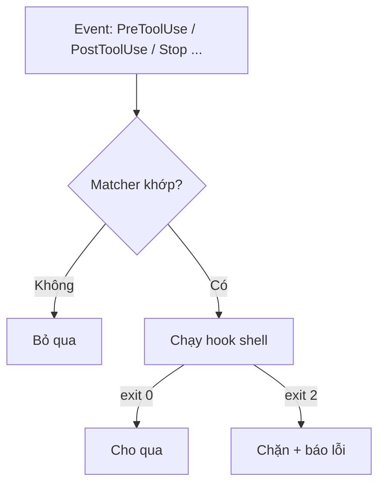

# FAQ 05 — Hooks: vì sao không chạy?

> **Bài này cho ai:** bạn đã gắn hook (PreToolUse, PostToolUse, Stop...) nhưng hook im re, chạy muộn, hoặc muốn biết nên viết loại hook nào cho an toàn.
> **Cần gì trước:** đã cài và đăng nhập Claude Code ([FAQ 01](01-tai-khoan-pricing-cai-dat.md)); đọc [bài 07 — hooks & tự động hóa](../01-huong-dan-su-dung/07-hooks-tu-dong-hoa.md) là đủ.
> **Đọc xong bạn làm được:**
> - Tự debug hook không lửa theo thứ tự: event → matcher → trust → headless → version.
> - Chọn đúng loại hook (command/prompt/agent/HTTP) và viết hook chặn/sửa/verify không treo khi chạy `-p` hay CI.
> - Thiết kế Stop-gate hội tụ, không bị override; kiểm tra hook còn sống sau mỗi `claude update`.
> **Thời gian:** ~12 phút

## Thuật ngữ dùng trong bài này

| Thuật ngữ | Hiểu nôm na là gì | Ví dụ thấy ngay |
|---|---|---|
| Hook | Script Claude Code tự chạy khi có sự kiện, **không** qua model nên không tốn token | `./scripts/guard-no-push-main.sh` chạy trước lệnh `Bash` |
| Event | Thời điểm hook được kích hoạt (PreToolUse, PostToolUse, Stop...) | `PreToolUse` chạy trước khi tool thực thi |
| Matcher | Bộ lọc chọn tool nào thì hook lửa; phân biệt cả chữ hoa/thường | `"matcher": "Edit\|Write"` |
| stdin | Dữ liệu JSON Claude Code đẩy vào hook để script đọc | `echo '{"tool_name":"Bash",...}' \| ./hook.sh` |
| Headless | Chạy `-p`/background/CI, không có người bấm Yes/No | `claude -p "..."` |
| Trust | Xác nhận folder tin cậy — hook trong frontmatter mới chạy | dialog "trust this folder?" lúc mở folder |

## Mục lục

- [Sơ đồ nhanh](#sơ-đồ-nhanh)
- [Bảng tổng hợp: 4 loại hook + debug nhanh](#bảng-tổng-hợp-4-loại-hook--debug-nhanh)
- [1. Hook không lửa — debug theo thứ tự nào? (event → matcher → dry-run)](#1-hook-không-lửa--debug-theo-thứ-tự-nào)
- [2. Folder đã trust chưa?](#2-folder-đã-trust-chưa)
- [3. Chạy headless (`-p`/CI) — hook nào cần prompt?](#3-chạy-headless-pci--hook-nào-cần-prompt)
- [4. Hai hook cùng sửa `updatedInput` — ai thắng?](#4-hai-hook-cùng-sửa-updatedinput--ai-thắng)
- [5. Stop hook: interrupt, StopFailure và gate bị override sau 8 block](#5-stop-hook-interrupt-stopfailure-và-gate-bị-override-sau-8-block)
- [6. Prompt-hook / agent-hook / command-hook — chọn loại nào?](#6-prompt-hook--agent-hook--command-hook--chọn-loại-nào)
- [7. Hook API đổi theo version — chống drift sao?](#7-hook-api-đổi-theo-version--chống-drift-sao)
- [Vẫn lỗi thì sao? (hooks)](#vẫn-lỗi-thì-sao-hooks)

---

## Sơ đồ nhanh



## Bảng tổng hợp: 4 loại hook + debug nhanh

| Loại hook | Chạy ở đâu | Tốn gì | Dùng khi nào |
|---|---|---|---|
| Command (shell script) | Máy bạn, chạy cố định | 0 model tokens, vài ms–s | Production ưu tiên (lint, guard, format) |
| Prompt (LLM 1-turn, Haiku default) | Model chấm 1 lượt | Ít tokens | Cần judgment từ input (prompt có risky?) |
| Agent (experimental, 60s/50 turns) | Subagent verify | Nhiều tokens | Verify cần đọc code/chạy lệnh |
| HTTP / MCP-tool | Ngoài (webhook/service) | Network | Tích hợp hệ ngoài (ticket, audit log) |

| Hook không lửa → check | Lệnh |
|---|---|
| Đúng event chưa? | `/hooks` xem theo tool events |
| Matcher đúng case chưa? | `Edit` ≠ `edit`, `Bash` ≠ `bash` |
| Folder trusted chưa? | Mở lại folder → trust dialog |
| Headless (`-p`) có cần prompt? | Thiết kế headless, không prompt |
| Hook lỗi/timeout thì sao? | `onFailure: "block"` (≥2.1.295) = chặn luôn; mặc định thả qua |
| Version đổi schema? | `/status` + release notes |

---

## 1. Hook không lửa — debug theo thứ tự nào? (event → matcher → dry-run)

> **Hỏi ngắn gọn:** gắn hook rồi mà nó không chạy, hoặc chạy nhưng không kịp chặn — kiểm tra gì trước?
>
> **Trả lời 1 câu:** Gõ `/hooks` xem hook có được nạp không, rồi check 2 bệnh #1 #2: sai event, sai matcher case.

**Bệnh #1 — sai event.** Mỗi event lửa ở một thời điểm khác nhau; gắn nhầm là hook không bao giờ chạy đúng lúc:

| Muốn | Event đúng | Gắn nhầm hay gặp |
|---|---|---|
| Chặn trước khi chạy | `PreToolUse` | Gắn `PostToolUse` (xong rồi mới check = muộn) |
| Check/sửa sau khi chạy | `PostToolUse` | Gắn `PreToolUse` (chưa có output để check) |
| Gate khi Claude xong | `Stop` | Tưởng lửa khi user interrupt (không lửa — xem câu 5) |
| Chạy đầu session | `SessionStart` | Tưởng lửa mỗi prompt (chỉ 1 lần) |
| Check prompt user | `UserPromptSubmit` | Tưởng chặn được tool (chỉ thấy prompt) |

**Bệnh #2 — matcher sai case.** Tên tool phải viết hoa đúng: `Edit`, `Write`, `Bash`, `Read`. Gõ `edit`, `bash` thường → không khớp → im re, không báo lỗi.

```json
{
  "hooks": {
    "PreToolUse": [{ "matcher": "Bash", "hooks": [{ "type": "command", "command": "./scripts/guard-no-push-main.sh" }] }]
  }
}
```

Dry-run hook tay với stdin mẫu — không ra JSON đúng là script hỏng, không phải matcher:

```bash
/hooks    # xem tất cả hooks theo events — hook không list = config sai file/JSON parse lỗi
echo '{"tool_name":"Bash","tool_input":{"command":"git push origin main"}}' | ./scripts/guard-no-push-main.sh
# → phải ra {"decision":"block",...}
```

**Đào sâu:** [bài 07 — hooks & tự động hóa](../01-huong-dan-su-dung/07-hooks-tu-dong-hoa.md) · [lệnh `/hooks`](../01-huong-dan-su-dung/commands/knowledge-system/hooks/README.md)

---

## 2. Folder đã trust chưa?

> **Hỏi ngắn gọn:** máy tôi hook chạy ầm ầm, máy đồng nghiệp clone về thì im — do đâu?
>
> **Trả lời 1 câu:** Do folder chưa được trust — hooks gắn trong project files (frontmatter của subagent/skill) chỉ chạy khi workspace đã xác nhận tin cậy.

Chưa trust → skip + log mờ, dễ tưởng "hook hỏng". `-p` headless không tính là trusted. Ngoại lệ chạy luôn: user-level agents (`~/.claude/agents/`) và `--agents` inline JSON.

```bash
/agents    # xem agents + hooks kèm
# Mở folder trong terminal/IDE → hiện "trust this folder?" → Accept → chạy lại
```

Hook format của agent chạy trên máy bạn (đã trust) nhưng im trên máy đồng nghiệp (bấm Deny trust) → đúng 1 nguyên nhân này.

**Đào sâu:** [lệnh `/agents`](../01-huong-dan-su-dung/commands/knowledge-system/agents/README.md) · [FAQ 03 — permissions & modes](03-permissions-modes.md)

---

## 3. Chạy headless (`-p`/CI) — hook nào cần prompt?

> **Hỏi ngắn gọn:** hook chạy ngon khi ngồi terminal, nhưng lên CI hoặc `-p` thì treo tới timeout — vì sao?
>
> **Trả lời 1 câu:** Headless không có người bấm Yes/No — hook nào `read -p`, mở editor, gọi OAuth browser sẽ treo tới timeout rồi fail mờ.

```bash
# ✅ Hook headless-safe: đọc stdin, in JSON, thoát
#!/bin/bash
input=$(cat)
echo "$input" | grep -q 'rm -rf' && echo '{"decision":"block","reason":"deny rm-rf"}' && exit 0
echo '{"decision":"approve"}'

# ❌ TRONG HOOK: read -p "chắc không?"; vim file; open browser...
```

Từ ≥2.1.295, khai thêm `onFailure: "block"` để hook lỗi/timeout thì **chặn** hành động thay vì thả qua — dùng cho guard critical trong CI, để lỗi không âm thầm mở toang.

Mọi hook sẽ chạy trong `-p`/background/CI → test bằng pipe stdin tay ([câu 1](#1-hook-không-lửa--debug-theo-thứ-tự-nào)), không test bằng tay gõ.

**Đào sâu:** [FAQ 10 — CI, SDK, routines, Web](10-ci-sdk-routines-web.md) · [bài 07 — hooks & tự động hóa](../01-huong-dan-su-dung/07-hooks-tu-dong-hoa.md)

---

## 4. Hai hook cùng sửa `updatedInput` — ai thắng?

> **Hỏi ngắn gọn:** hai hook cùng rewrite input của một tool — hook nào quyết định kết quả cuối?
>
> **Trả lời 1 câu:** Hook nào finish **cuối** thì thắng, mà thứ tự finish không đảm bảo — nên đừng để overlap: 1 matcher → 1 hook sửa input, các hook khác chỉ approve/block.

```json
{ "hooks": { "PreToolUse": [{ "matcher": "Edit", "hooks": [{ "type": "command", "command": "./scripts/normalize-edit.sh" }] }] } }
```

```text
✅ 1 hook sửa Edit-input + 1 hook block Bash-nguy-hiểm (khác matcher, không clash)
❌ 2 hooks cùng rewrite Bash command (clash, thắng thua hui)
```

**Đào sâu:** [tips 06 — công thức hooks](../02-tips-thuc-chien/06-hooks-recipes.md) · [bài 07 — hooks & tự động hóa](../01-huong-dan-su-dung/07-hooks-tu-dong-hoa.md)

---

## 5. Stop hook: interrupt, StopFailure và gate bị override sau 8 block

> **Hỏi ngắn gọn:** viết Stop hook để gate "xong việc" mà bấm Esc là thoát được, hoặc gate tự nhiên bị bỏ qua sau vài lần block — sao vậy?
>
> **Trả lời 1 câu:** Interrupt (Esc/Ctrl-C) không lửa `Stop` (API error lửa event riêng `StopFailure`); sau **8 lần block liên tiếp** Claude được override để thoát (chống treo vô hạn) — gate phải thiết kế hội tụ.

```json
{
  "hooks": {
    "Stop": [{ "hooks": [{ "type": "command", "command": "./scripts/verify-done.sh" }] }],
    "StopFailure": [{ "hooks": [{ "type": "command", "command": "./scripts/report-failure.sh" }] }]
  }
}
```

```text
❌ "Chưa hoàn hảo thì block" (không bao giờ đạt → override ở block 8)
✅ "Test đỏ thì block + chỉ rõ file; quá 5 lần thì cho qua với warning" (hội tụ)
```

Gate chặn CI push/merge → luôn có đường "cho qua có điều kiện" trước block 8, và chấp nhận interrupt là đường thoát hợp lệ của user — đừng trông chờ Stop-hook chống interrupt.

**Đào sâu:** [tips 06 — công thức hooks](../02-tips-thuc-chien/06-hooks-recipes.md) · [FAQ 08 — lỗi thường gặp](08-loi-thuong-gap-troubleshooting.md)

---

## 6. Prompt-hook / agent-hook / command-hook — chọn loại nào?

> **Hỏi ngắn gọn:** cùng 1 việc guard được mà có 4 loại hook — khi nào nên dùng loại nào?
>
> **Trả lời 1 câu:** Ưu tiên command (shell) trước; chỉ lên prompt/agent khi shell không diễn đạt nổi. Hook chạy bằng quyền user của bạn nên chỉ cài từ nguồn tin cậy.

1. **Command (shell):** chạy cố định, nhanh, 0 tokens, test được bằng pipe — mọi guard/lint/format dùng loại này.
2. **Prompt (LLM 1-turn, Haiku default):** cần *judgment* từ input mà regex không viết nổi (VD: "prompt này có ý định xóa DB không?").
3. **Agent (experimental, 60s/50 turns trần):** verify cần đọc code + chạy lệnh — đắt, chỉ gate quan trọng.
4. **HTTP/MCP-tool:** tích hợp ngoài (ghi audit log, gọi policy service).

```json
{ "hooks": { "UserPromptSubmit": [{ "hooks": [{ "type": "prompt", "prompt": "Prompt này có yêu cầu xóa/ghi đè không backup? Trả lời block/approve." }] }] } }
```

Vì hook chạy bằng quyền của bạn (đọc FS, gọi network, ghi disk — hook độc = RCE trá hình), trước khi cài plugin/skill lạ có hooks: đọc scripts, check `git grep -E 'curl|rm -rf|sudo' -- .claude/hooks/`, chỉ trust nguồn quen (xem [FAQ 09](09-bao-mat-quyen-rieng-tu.md)).

**Đào sâu:** [bài 07 — hooks & tự động hóa](../01-huong-dan-su-dung/07-hooks-tu-dong-hoa.md) · [FAQ 09 — bảo mật & riêng tư](09-bao-mat-quyen-rieng-tu.md)

---

## 7. Hook API đổi theo version — chống drift sao?

> **Hỏi ngắn gọn:** hook hôm qua chạy ngon, sau `claude update` lại tắt ngóm — làm sao biết API nào đổi?
>
> **Trả lời 1 câu:** Mọi khẳng định theo version phải ghi **bản tối thiểu** (VD: `onFailure: "block"` cần ≥2.1.295), và sau mỗi lần update thì chạy lại dry-run cho từng hook.

1. **Ghi version floor ngay trong config/comment:** `# cần ≥2.1.295` cạnh hook dùng tính năng mới — 6 tháng sau đọc lại vẫn biết vì sao.
2. **Dry-run lại sau mỗi `claude update`:** pipe JSON mẫu vào từng hook, so output trước/sau — exit code + JSON fields là hợp đồng ổn định nhất, các field mới có thể thêm/bỏ.
3. **Đối chiếu [WRITING-STYLE.md — Phần B](../WRITING-STYLE.md)** (bản v2.1.296): bảng "tính năng | version tối thiểu" là nguồn sự thật của repo này.
4. **Hook im re sau update?** Rơi lại đúng chuỗi debug câu 1: event → matcher → trust → headless → version.

```bash
# dry-run mẫu — hook nhận cùng JSON thật từ stdin
echo '{"tool_name":"Bash","tool_input":{"command":"git push"}}' | ./scripts/guard-no-push-main.sh; echo "exit=$?"
```

**Đào sâu:** [Phần B — dữ kiện chuẩn](../WRITING-STYLE.md#phần-b--dữ-kiện-chuẩn-làm-tròn-thời-gian-11102026) · [FAQ 08 — lỗi thường gặp](08-loi-thuong-gap-troubleshooting.md)

---

## Vẫn lỗi thì sao? (hooks)

1. Dry-run bằng pipe JSON mẫu (lệnh ở câu 7) — hook chạy độc lập ổn không?
2. `/hooks` trong session — hook đã đăng ký, đúng event + matcher chưa?
3. Kiểm tra trust dialog của folder + hook nằm trong frontmatter/settings đúng chỗ.
4. `claude --debug` chạy 1 turn ngắn — xem hook có fire và exit code là bao nhiêu.
5. Vẫn lạ → `/debug` chẩn đoán session; nghi lỗi core thì `/bug`.

Thứ tự debug chung mọi lỗi: `/status` → `claude doctor` → `/permissions` → `/debug` → `/bug` — chi tiết [FAQ 08](08-loi-thuong-gap-troubleshooting.md).

**Tham khảo chéo:** [bài 07 — hooks & tự động hóa](../01-huong-dan-su-dung/07-hooks-tu-dong-hoa.md) · [FAQ 03](03-permissions-modes.md) (permission mode) · [FAQ 10](10-ci-sdk-routines-web.md) (hooks trong CI)

> Mẹo 1 dòng: _debug theo thứ tự event → matcher → trust → headless → version; Stop-gate phải hội tụ trước khi bị block 8 lần; dry-run lại sau mỗi `claude update`._
