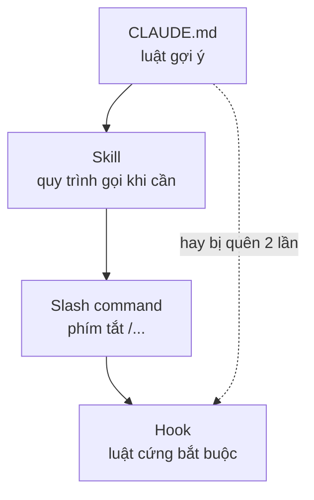

# FAQ 06 — Skill, command & CLAUDE.md

> **Bài này cho ai:** bạn đang rối giữa CLAUDE.md, rules, skill, slash command, hook — hoặc viết skill rồi mà nó không tự chạy (gồm 8 câu hỏi).
> **Cần gì trước:** đã dùng Claude Code vài lần; đọc [FAQ 01](01-tai-khoan-pricing-cai-dat.md) nếu chưa rõ cài đặt.
> **Đọc xong bạn làm được:** phân biệt cái nào để ở đâu; viết skill auto-trigger đúng; giữ CLAUDE.md <200 dòng; debug skill không tự chạy, headless bị deny.
> **Thời gian:** ~12 phút

## Thuật ngữ dùng trong bài này

| Thuật ngữ | Hiểu nôm na là gì | Ví dụ thấy ngay |
|---|---|---|
| CLAUDE.md | File luật gợi ý cho model, nạp lại mọi turn | `CLAUDE.md` ở gốc repo |
| AGENTS.md | Chuẩn chéo công cụ, Claude Code đọc trực tiếp (w34/2026) | `AGENTS.md` ở gốc repo |
| Slash command | Phím tắt `/x` gõ trong session | `/deploy`, `/init` |
| Skill | Gói quy trình/tài liệu model tự gọi khi description khớp | `.claude/skills/deploy/SKILL.md` |
| Frontmatter | Khối `---` đầu file skill, chứa `name`, `description`... | `name: deploy` |
| Auto-trigger | Model tự gọi skill khi thấy việc khớp mô tả, không cần bạn gõ | Bạn nói "lên staging" → skill `deploy` tự chạy |
| Rules | Luật chỉ áp cho 1 thư mục, khai trong `.claude/rules/` + `paths` | `api/**` phải dùng ESM |
| Hook | Lệnh shell chạy ngoài model theo event, bắt buộc thực thi | `PreToolUse` chặn push main |

## Mục lục

- [Sơ đồ nhanh](#sơ-đồ-nhanh)
- [Bảng tổng hợp: CLAUDE.md vs rules vs skill vs command vs hook](#bảng-tổng-hợp-claudemd-vs-rules-vs-skill-vs-command-vs-hook)
- [1. Custom command và skill có phải một thứ?](#1-custom-command-và-skill-có-phải-một-thứ)
- [2. Skill đặt ở đâu + frontmatter gồm gì?](#2-skill-đặt-ở-đâu--frontmatter-gồm-gì)
- [3. `$ARGUMENTS`, `!cmd` và `${VARS}` dùng sao?](#3-arguments-cmd-và-vars-dùng-sao)
- [4. Skill không auto-trigger — debug sao?](#4-skill-không-auto-trigger--debug-sao)
- [5. Có skill nào đi kèm (bundled) đáng dùng?](#5-có-skill-nào-đi-kèm-bundled-đáng-dùng)
- [6. CLAUDE.md ranh giới ở đâu, `/init` hay viết tay?](#6-claudemd-ranh-giới-ở-đâu-init-hay-viết-tay)
- [7. `context: fork` là gì?](#7-context-fork-là-gì)
- [8. `allowed-tools` + `${CLAUDE_SKILL_DIR}` để làm gì?](#8-allowed-tools--claude_skill_dir-để-làm-gì)
- [Vẫn lỗi thì sao? (skill/command)](#vẫn-lỗi-thì-sao-skillcommand)

---

## Sơ đồ nhanh



## Bảng tổng hợp: CLAUDE.md vs rules vs skill vs command vs hook

| Nơi | Load khi nào | Tốn bao nhiêu | Chứa gì |
|---|---|---|---|
| CLAUDE.md (<200 dòng) | Mọi turn | Đắt nhất (trả mãi mãi) | Dữ kiện luôn nạp: stack, lệnh, cấu trúc, quy ước bất di bất dịch |
| `.claude/rules/` + `paths` | Khi chạm path khớp | Rẻ (chỉ khi cần) | Luật theo thư mục (`api/**`, `web/**`) |
| Skills (auto-trigger) | Khi description khớp task | ~100 tokens lúc idle, body khi gọi | Quy trình, tài liệu dài |
| Custom commands (gọi tay `/x`) | Khi bạn gõ | 0 khi không gọi | Tác vụ gọi tay |
| Hooks | Khi event lửa | 0 model tokens | Luật bắt buộc (model hay miss) |
| `/memory` | Theo user | Nhẹ | Sở thích cá nhân, không phải luật team |

Quy tắc 1 dòng: **dữ kiện luôn nạp → CLAUDE.md, luật theo path → rules, quy trình → skills, gọi tay → commands, hay miss → hooks.**

---

## 1. Custom command và skill có phải một thứ?

> **Hỏi ngắn gọn:** `.claude/commands/` và `.claude/skills/` có giống nhau không, viết mới thì chọn cái nào?
> **Trả lời 1 câu:** Cùng tạo ra `/x`, nhưng nên viết mới bằng skill vì skill thêm được auto-trigger và support files.

`.claude/commands/x.md` ≡ `.claude/skills/x/SKILL.md` → cùng ra `/x`; file command cũ vẫn chạy, không vỡ. Skill hơn ở 3 điểm: frontmatter giàu hơn, mang được support files (scripts/references), và **auto-trigger** (model tự gọi khi description khớp).

```text
.claude/commands/deploy.md       -> /deploy (gọi tay, cũ, vẫn chạy)
.claude/skills/deploy/SKILL.md   -> /deploy (gọi tay + auto-trigger, mới, nên dùng)
```

File cũ để yên. Viết mới → skill; muốn gộp dần thì move nội dung sang `SKILL.md`, giữ nguyên tên → `/x` không đổi, user không phải học lại.

**Đào sâu:** [Bài 05 — skills & custom commands](../01-huong-dan-su-dung/05-skills-custom-commands.md) · [FAQ 05 — hooks](05-hooks-faq.md)

---

## 2. Skill đặt ở đâu + frontmatter gồm gì?

> **Hỏi ngắn gọn:** Viết skill mới để thư mục nào, trong `SKILL.md` cần khai gì?
> **Trả lời 1 câu:** Chọn chỗ theo "ai dùng" (personal/project/plugin); frontmatter là mặt tiền model đọc để quyết định có gọi — quan trọng nhất `name` + `description`.

Chọn vị trí:

| Vị trí | Đường dẫn | Ai thấy | Dùng khi nào |
|---|---|---|---|
| Personal | `~/.claude/skills/<tên>/` | Mọi project của bạn | Workflow cá nhân (review style của bạn) |
| Project | `.claude/skills/<tên>/` | Cả team (commit) | Chuẩn team (deploy, migrate, triage) |
| Plugin | `<plugin>/skills/<tên>/` | Ai cài plugin | Phân phối rộng, gọi theo namespace `/plugin:skill` |

Frontmatter:

| Field | Ý nghĩa | Ví dụ |
|---|---|---|
| `name` | Tên skill (= `/tên`) | `deploy` |
| `description` | Khi nào gọi. **Câu đầu = use case**, truncate ~1536 ký tự | `Deploy staging/prod đúng chuẩn. Dùng khi release...` |
| `allowed-tools` | Pre-approve tools trong lượt gọi | `Bash(npm run deploy:*)` |
| `disable-model-invocation` | `true` = chỉ gọi tay, model không tự trigger (từ 2.1.196 cũng chặn scheduled fire) | `true` cho skill nguy hiểm |
| `context: fork` + `agent:`/`model:` | Chạy cô lập trong subagent (không thấy history); ép agent/model khi fork | `context: fork`, `model: haiku` cho rẻ |

Template copy-paste:

```markdown
---
name: deploy
description: Deploy staging/prod đúng chuẩn team (migrate + smoke + rollback). Dùng khi release, lên staging, rollback prod.
allowed-tools: Bash(npm run deploy:*), Bash(npm run migrate:*), Read
---
# Deploy
1. Chạy migrate trước (`npm run migrate`).
2. Deploy (`npm run deploy <env> $ARGUMENTS`).
3. Smoke test 3 endpoints. Đỏ → rollback ngay, không fix tiếp.
```

Mọi skill mới: điền đủ `name/description/allowed-tools` trước, còn lại thêm khi cần. Check: `ls ~/.claude/skills/ && ls .claude/skills/`.

**Đào sâu:** [Bài 05 — skills & custom commands](../01-huong-dan-su-dung/05-skills-custom-commands.md) · [templates/](../templates/) · [Tip 07 — thiết kế skills](../02-tips-thuc-chien/07-thiet-ke-skills.md)

---

## 3. `$ARGUMENTS`, `!cmd` và `${VARS}` dùng sao?

> **Hỏi ngắn gọn:** Ba cơ chế đưa input động vào skill khác nhau thế nào?
> **Trả lời 1 câu:** `$ARGUMENTS` nhận tham số khi gọi, `` !`cmd` `` nhét output shell thật, `${CLAUDE_SKILL_DIR}` / `${CLAUDE_PROJECT_DIR}` trỏ đường dẫn tuyệt đối.

- **`$ARGUMENTS`:** input khi gọi (`/deploy staging` → `$ARGUMENTS` = `staging`).
- **`` !`cmd` ``:** chạy shell TRƯỚC, thay output thật vào prompt (VD: nhét `git status` hiện tại vào — model không phải đoán).
- **`${CLAUDE_SKILL_DIR}` / `${CLAUDE_PROJECT_DIR}`:** đường dẫn tuyệt đối, dùng trong content + `allowed-tools` (skill đặt đâu cũng chạy).

```markdown
---
name: deploy
description: Deploy đúng chuẩn. Dùng khi release.
---
# Deploy $ARGUMENTS
Env: $ARGUMENTS (VD: staging, prod).
Trạng thái hiện tại: !`git status --short`
Script: ${CLAUDE_SKILL_DIR}/scripts/smoke.sh
```

Chạy `/deploy staging` thật để xác nhận: thấy "Env: staging" (= `$ARGUMENTS`), thấy output git status thật, và smoke.sh chạy đúng path. Skill nào cũng nên có `$ARGUMENTS` (linh hoạt) + `` !`cmd` `` cho context tươi.

---

## 4. Skill không auto-trigger — debug sao?

> **Hỏi ngắn gọn:** Tại sao skill mình viết lại không bao giờ tự chạy, chỉ chạy khi gõ tay?
> **Trả lời 1 câu:** Kiểm 3 nguyên nhân theo thứ tự: description không khớp, `disable-model-invocation: true`, rồi `skillOverrides` tắt.

1. **`description`/`when_to_use` không khớp cách bạn diễn đạt:** model match theo ngữ nghĩa. Bạn nói "lên hàng staging" mà description ghi "production release orchestration" → không khớp.
2. **`disable-model-invocation: true`:** ai đó chặn model tự gọi → chỉ gọi tay được.
3. **`skillOverrides` tắt:** settings tắt skill đó → không trigger dù description đẹp.

```markdown
# ❌ MỜ: buzzwords, không ai nói thế
description: Orchestrate synergistic deployment workflows leveraging best practices.
# ✅ RÕ: khớp cách user nói + use case đầu câu
description: Deploy staging/prod và rollback. Dùng khi user nói "deploy", "lên staging", "rollback", "release".
when_to_use: Khi user nhắc deploy/staging/prod/release/rollback.
```

```bash
# Check 2 cái còn lại (2 lệnh RỖNG nghĩa: lỗi ở description, bước 1):
git grep -n 'disable-model-invocation' -- .claude/skills/<tên>/
git grep -n 'skillOverrides' -- .claude/settings*.json
```

**Đào sâu:** [lệnh `skill-doctor`](../01-huong-dan-su-dung/commands/knowledge-system/skill-doctor/README.md) · [Tip 07 — thiết kế skills](../02-tips-thuc-chien/07-thiet-ke-skills.md)

---

## 5. Có skill nào đi kèm (bundled) đáng dùng?

> **Hỏi ngắn gọn:** Có skill nào đi kèm sẵn trong Claude Code không, cái nào đáng thử trước?
> **Trả lời 1 câu:** Có — bộ skill bundled khỏi cài; mới onboard thì thử `/doctor` + `/verify` trước.

| Skill | Việc | Khi nào gọi |
|---|---|---|
| `/doctor` | Khám sức khoẻ repo/setup | Mỗi tháng, repo mới |
| `/code-review` | Review thường | Mọi PR vừa-tầm |
| `/ultrareview` | Review sâu (sandbox) | PR lớn, security-critical |
| `/batch` | Chia change lớn thành 5–30 worktree-subagents | Epic, migrate lớn |
| `/debug` | Chẩn đoán session lạ | Đang làm mà sai sai |
| `/loop` | Lặp task tới khi xanh | Flaky fix, migrate từng phần |
| `/claude-api [migrate\|managed-agents-onboard]` | Migrate/onboard agents | Đổi provider, onboard team |
| `/verify` | Chạy app thật kiểm chứng | Sau khi code xong (thay vì tin model nói) |
| `/simplify` | Rút gọn code | Sau implement, trước review |
| `/insights` | Thói quen team (HTML) | Cuối sprint |
| `/skill-doctor` | Tìm skill không dùng (cần ≥2.1.252) | Định kỳ dọn skill ế |

Mới onboard → `/doctor` (bảng điểm xanh = setup OK, dòng đỏ = vá trước) rồi `/verify` ("PASS: 3/3 endpoints" = chạy đúng). PR lớn → `/code-review`, chưa đủ sâu → `/ultrareview`.

**Đào sâu:** [lệnh `code-review`](../01-huong-dan-su-dung/commands/code-repo/code-review/README.md) · [lệnh `batch`](../01-huong-dan-su-dung/commands/code-repo/batch/README.md) · [lệnh `verify`](../01-huong-dan-su-dung/commands/code-repo/verify/README.md)

---

## 6. CLAUDE.md ranh giới ở đâu, `/init` hay viết tay?

> **Hỏi ngắn gọn:** CLAUDE.md dày bao nhiêu là quá, sinh CLAUDE.md bằng `/init` hay viết tay?
> **Trả lời 1 câu:** CLAUDE.md nạp lại mọi turn nên chỉ giữ dữ kiện luôn nạp (<200 dòng); có code → `/init`, repo trống → copy `templates/CLAUDE.md`.

**Ranh giới** — CLAUDE.md chỉ giữ dữ kiện luôn nạp, còn lại đẩy ra ngoài:

- Quy trình dài, tài liệu tham chiếu, checklist → **skill** (load khi cần).
- Luật chỉ đúng cho 1 thư mục → **`.claude/rules/` + `paths`** (VD: `api/**` dùng ESM, `migrations/**` không sửa tay).
- Luật nhắc 3 lần vẫn miss → **hook** (bắt buộc, 0 tokens).

Chuẩn chéo công cụ: `AGENTS.md` được Claude Code đọc trực tiếp, không cần `CLAUDE.md` (w34/2026) — chạy song song với Cursor, Codex... cùng một file luật.

**Sinh CLAUDE.md:**

- **Có sẵn codebase → `/init`:** quét code thật, sinh từ thực tế. Thử `CLAUDE_CODE_NEW_INIT=1` cho flow interactive. Xong → **xóa 50%** (nó sinh thừa) + thêm verified commands (lệnh đã chạy thật).
- **Project mới (trống) → template:** copy `templates/CLAUDE.md` rồi sửa — không có gì để init quét (xem [FAQ 01 câu 6](01-tai-khoan-pricing-cai-dat.md#6-repo-mới-5-lệnh-setup-đầu--copy-templatesclaudemd)).

```bash
wc -l CLAUDE.md && /doctor claude-md   # mỗi tháng 1 lần
# VD: 80 dòng "quy trình deploy 12 bước" → chuyển sang skill `deploy`,
#     CLAUDE.md giữ 1 dòng "deploy → /deploy". Tiết kiệm ~800 tokens/session.
```

Dòng nào 10 turn gần nhất không dùng → chuyển ra skill/rules. Đã có mà phình → không init lại, mà tách.

**Đào sâu:** [Bài 03 — CLAUDE.md, memory & rules](../01-huong-dan-su-dung/03-claude-md-memory-rules.md) · [Tip 01 — context hygiene](../02-tips-thuc-chien/01-context-hygiene.md) · [lệnh `init`](../01-huong-dan-su-dung/commands/code-repo/init/README.md)

---

## 7. `context: fork` là gì?

> **Hỏi ngắn gọn:** `context: fork` khác chạy skill bình thường ở điểm nào, khi nào nên bật?
> **Trả lời 1 câu:** Skill `context: fork` chạy trong subagent cô lập, không thấy history của phiên chính — hợp cho skill đọc nhiều trả ít, không hợp cho skill cần mạch đang làm.

Agent `Explore`/`Plan` khi fork còn skip CLAUDE.md + git status để gọn context.

```markdown
---
name: explore-auth
description: Quét auth flow trả tóm tắt. Dùng khi cần hiểu auth mà không muốn loãng context.
context: fork
agent: Explore
model: haiku
---
```

Gọi skill fork → "subagent" chạy riêng rồi trả tóm tắt; session chính không bị ngập log quét. Skill đọc nhiều + trả ít (research, audit, quét) → fork; skill viết/sửa tiếp mạch đang làm → không fork.

**Đào sâu:** [FAQ 07 — subagents & teams](07-subagents-teams-workflows.md) · [lệnh `fork`](../01-huong-dan-su-dung/commands/session-context/fork/README.md) · [Tip 07 — thiết kế skills](../02-tips-thuc-chien/07-thiet-ke-skills.md)

---

## 8. `allowed-tools` + `${CLAUDE_SKILL_DIR}` để làm gì?

> **Hỏi ngắn gọn:** Không điền `allowed-tools` thì skill chạy `-p` bị deny; skill có script kèm thì trỏ path thế nào?
> **Trả lời 1 câu:** `allowed-tools` pre-approve tool skill cần (không phải bypass org — deny/managed vẫn thắng); `${CLAUDE_SKILL_DIR}` trỏ đúng folder skill dù nó ở personal/project/plugin.

**`allowed-tools`** — skill deploy cần `npm run migrate` mà không pre-approve → headless deny (xem [FAQ 03](03-permissions-modes.md)). Điền hẹp-đúng, test 1 lần bằng `claude -p "chạy skill triage ticket 123"` → chạy xong không hiện dialog hỏi quyền; thiếu tool → log báo deny.

```markdown
---
name: triage
description: Lấy ticket về tóm tắt + tạo branch.
allowed-tools: Read, Glob, Grep, Bash(git checkout:*), Bash(gh issue:*)
---
# Triage $ARGUMENTS
Ticket: lấy ticket về tóm tắt.
Smoke: `${CLAUDE_SKILL_DIR}/scripts/smoke.sh $ARGUMENTS`
Chi tiết: xem `${CLAUDE_SKILL_DIR}/references/runbook.md`
```

**`${CLAUDE_SKILL_DIR}`** — skill mang được support files (`scripts/`, `references/`, `templates/`) đặt cạnh `SKILL.md`; biến này trỏ đúng folder skill ở mọi vị trí → di skill personal/project/plugin rồi gọi lại `/deploy staging`, scripts + runbook vẫn resolve đúng chỗ, không "file not found".

Skill có script/checklist dùng lại → đóng gói chung folder skill, đừng để script lang thang ngoài repo.

**Đào sâu:** [FAQ 03 — permissions & modes](03-permissions-modes.md) · [Bài 05 — skills & custom commands](../01-huong-dan-su-dung/05-skills-custom-commands.md) · [templates/](../templates/)

---

## Vẫn lỗi thì sao? (skill/command)

Đi hết thứ tự chung trước: `/status` → `claude doctor` → `/permissions` → `/debug` → `/bug` (chi tiết [FAQ 08](08-loi-thuong-gap-troubleshooting.md)). Riêng skill/command thì kiểm thêm:

1. Skill không hiện `/x` → check tên folder + `name` + file `SKILL.md` đúng chỗ (câu 2).
2. Không auto-trigger → description → `disable-model-invocation` → `skillOverrides` (câu 4).
3. Headless deny → `allowed-tools` + test `-p` (câu 8).
4. CLAUDE.md phình → `/doctor claude-md` → tách (câu 6).
5. `/debug` → chẩn đoán session; `/bug` nếu nghi core.

```bash
ls .claude/skills/
git grep -n 'disable-model-invocation' -- .claude/skills/
wc -l CLAUDE.md
```

---

**Tham khảo chéo:** [Bài 03 — CLAUDE.md, memory & rules](../01-huong-dan-su-dung/03-claude-md-memory-rules.md) · [Bài 05 — skills & custom commands](../01-huong-dan-su-dung/05-skills-custom-commands.md) · [Tip 07 — thiết kế skills](../02-tips-thuc-chien/07-thiet-ke-skills.md) · [FAQ 02](02-model-context-token.md) (token) · [FAQ 05](05-hooks-faq.md) (rule hay miss → hook) · [FAQ 07](07-subagents-teams-workflows.md) (fork skill)

> Mẹo 1 dòng: _dữ kiện vào CLAUDE.md, quy trình vào skills, và description viết bằng chính từ bạn sẽ nói._
