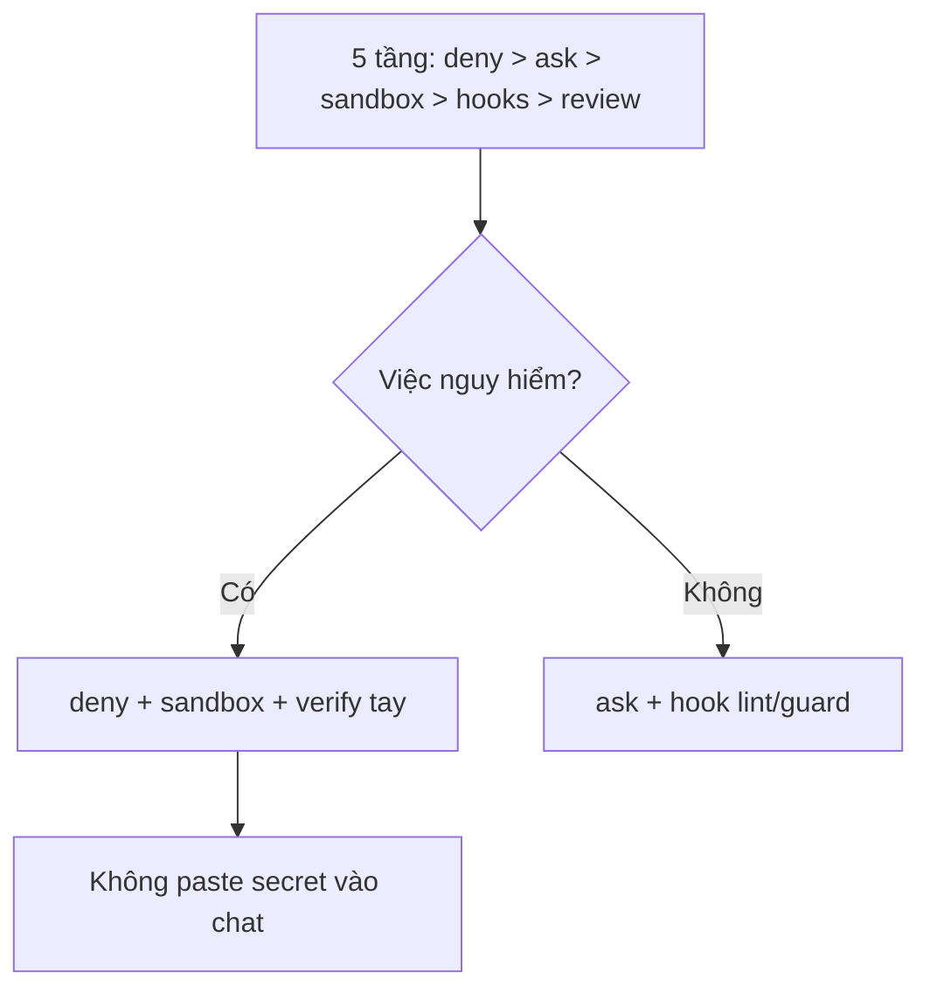

# FAQ 09 — Bảo mật & quyền riêng tư

> **Bài này cho ai:** bạn lo lộ code/secret, muốn chặn Claude chạm quá giới hạn đã cho phép, hoặc phải trả lời câu hỏi bảo mật/compliance (ZDR, telemetry, supply-chain).
> **Cần gì trước:** đã cài và đăng nhập Claude Code; hiểu sơ qua `/permissions`; chưa rõ deny/hook thì đọc [FAQ 03](03-permissions-modes.md) trước.
> **Đọc xong bạn làm được:** khóa working dirs; dựng các lớp chặn mà bypass không vô hiệu hóa được; khai secret qua env + xử lý secret lộ đúng thứ tự; biết ZDR/telemetry; soát skill/plugin/hook trước khi cài; review code AI 4 lớp; checklist repo mới 5 phút.
> **Thời gian:** ~12 phút

## Thuật ngữ dùng trong bài này

| Thuật ngữ | Hiểu nôm na là gì | Ví dụ thấy ngay |
|---|---|---|
| Working dirs | Các thư mục Claude được phép đọc; ngoài danh sách này nó không chạm tới | `/permissions` xem dirs hiện tại |
| Deny rule | Quy tắc chặn sẵn lệnh/file nguy hiểm trong settings | `deny: ["Bash(rm -rf:*)"]` |
| Hook | Script tự chạy trước/sau tool, nằm ngoài model nên bắt buộc thực thi | `PreToolUse` chặn lệnh critical ngay cả khi bypass |
| Bypass | Cờ bỏ qua mọi câu hỏi quyền, chỉ dùng trong sandbox cô lập | `--dangerously-skip-permissions` |
| ZDR | Cam kết không lưu giữ data của bạn sau khi xử lý | hợp đồng Enterprise qualified |
| Telemetry | Dữ liệu sử dụng và lỗi tự gửi về vendor | crash log gửi về Anthropic |
| Supply-chain | Rủi ro khi cài code từ bên ngoài vào máy mình | skill, plugin, hook từ cộng đồng |
| Secret | Chuỗi bí mật dùng để xác thực, phải giấu | API key, GitHub token, Slack token |

## Mục lục

- [Sơ đồ nhanh](#sơ-đồ-nhanh)
- [Bảng tổng hợp: 7 lớp phòng thủ](#bảng-tổng-hợp-7-lớp-phòng-thủ)
- [1. Claude Code có đọc hết máy tôi không? (working dirs + `--add-dir`)](#1-claude-code-có-đọc-hết-máy-tôi-không-working-dirs----add-dir)
- [2. Deny nào không bypass được + khi nào được dùng bypass?](#2-deny-nào-không-bypass-được--khi-nào-được-dùng-bypass)
- [3. Secrets: khai sao + lộ rồi xử lý thế nào?](#3-secrets-khai-sao--lộ-rồi-xử-lý-thế-nào)
- [4. ZDR + telemetry — hỏi ai, tắt ở đâu?](#4-zdr--telemetry--hỏi-ai-tắt-ở-đâu)
- [5. Skill, plugin, hook có nguy hiểm không? (rủi ro supply-chain)](#5-skill-plugin-hook-có-nguy-hiểm-không-rủi-ro-supply-chain)
- [6. Review code AI viết thế nào? (4 lớp)](#6-review-code-ai-viết-thế-nhào-4-lớp)
- [7. Checklist bảo mật repo mới (5 phút)](#7-checklist-bảo-mật-repo-mới-5-phút)
- [Vẫn lỗi thì sao? (bảo mật)](#vẫn-lỗi-thì-sao-bảo-mật)

---

## Sơ đồ nhanh



## Bảng tổng hợp: 7 lớp phòng thủ

| Lớp | Chặn gì | Lệnh/config | Bypass được? |
|---|---|---|---|
| Working dirs (`--add-dir`) | Đọc ngoài thư mục cho phép | `/permissions` xem dirs | Không (không add thì không chạm) |
| Permission deny rules | Lệnh/file nguy hiểm | `deny` trong settings | Bypass bỏ qua (trừ org) |
| `PreToolUse` hook deny | Việc critical | Script guard | **KHÔNG — thắng cả bypass** |
| Org `ask` (connectors/MCP nhạy cảm) | Exfil qua MCP | Managed policy | **KHÔNG — hook allow không nới được** |
| Secrets qua env | Lộ token vào git | `${VAR}` + `git grep` check | — (kỷ luật + CI check) |
| ZDR / provider telemetry | Data gửi về vendor | Contract + provider docs | Hỏi admin, đừng đoán |
| Supply-chain (skills/plugins/hooks) | Code độc trá hình | Đọc trước khi cài | — (review tay) |

---

## 1. Claude Code có đọc hết máy tôi không? (working dirs + `--add-dir`)

> **Hỏi ngắn gọn:** Claude Code có thể tự đọc mọi file trên máy tôi không?
> **Trả lời 1 câu:** Không — nó chỉ chạm được các thư mục trong working dirs (xem ở `/permissions`); mở rộng bằng `--add-dir`, giữ danh sách hẹp nhất có thể.

Thêm dir thừa = mở rộng vùng nổ (blast radius) khi có lệnh ngáo chạy trong session: task chỉ cần `api/` mà bạn mở cả repo + home → 1 lệnh `grep -r` ngáo là nó quét secrets khắp máy.

```bash
/permissions    # xem working dirs hiện tại
# → danh sách chỉ có repo hiện tại (hoặc 1-2 thư mục phụ), không thấy ~/
claude --add-dir ../shared-contracts
# ❌ claude --add-dir ~   (mở cả home cho 1 task nhỏ)
```

Mở session lạ/repo lạ → mở `/permissions` kiểm tra dirs trước khi cho Claude chạy lệnh. Đừng `bypassPermissions` trên máy dev.

**Đào sâu:** [FAQ 03 — permissions & modes](03-permissions-modes.md) · [lệnh `permissions`](../01-huong-dan-su-dung/commands/model-mode/permissions/README.md)

## 2. Deny nào không bypass được + khi nào được dùng bypass?

> **Hỏi ngắn gọn:** Bật bypass cho CI không ai bấm phím — có phải mọi quyền đều bị bỏ qua hết không, và flag này dùng được ở đâu?
> **Trả lời 1 câu:** Không phải hết — 3 thứ sống sót qua `--dangerously-skip-permissions`: `PreToolUse` hook deny, deny rules + org `ask` cho connector/MCP nhạy cảm, managed policy; còn flag này CHỈ dùng trong CI sandbox cô lập thật sự.

**Không bypass được:**

1. **`PreToolUse` hook deny** — thắng cả bypass (chi tiết [FAQ 03 câu 3](03-permissions-modes.md#3-hook-vs-permission-rule--ai-thắng)).
2. **Deny rules + org `ask` cho connectors/MCP nhạy cảm** — hooks/rules chỉ siết thêm, không nới được.
3. **Managed policy của org** — không gỡ được ở local.

Deny rule thường trong settings vẫn bị bypass bỏ qua → việc critical luôn đặt hook, đừng tin mỗi rule.

```bash
# Guard mẫu sống qua bypass:
#!/bin/bash
input=$(cat)
echo "$input" | grep -qE 'rm -rf|sudo ' && echo '{"decision":"block","reason":"critical blocked even with bypass"}' && exit 0
echo '{"decision":"approve"}'
```

**Bypass chỉ hợp lệ khi** nơi chạy là sandbox cô lập thật sự: container dùng 1 lần, không secrets thật, không network ra ngoài. Trên máy dev/cloud session bình thường: KHÔNG BAO GIỜ.

```bash
# ✅ Sandbox dùng 1 lần, không secrets thật:
claude -p "migrate test" --dangerously-skip-permissions
# ❌ Máy dev / máy có .env thật — thay bằng:
# --safe-mode (cân bằng an toàn hơn) hoặc --permission-mode dontAsk + allowlist hẹp (FAQ 10)
```

**Đào sâu:** [FAQ 03 câu 7 — `--dangerously-skip-permissions` / `--safe-mode`](03-permissions-modes.md#7-khi-nào-dùng---dangerously-skip-permissions) · [FAQ 05 — hooks](05-hooks-faq.md) · [FAQ 10 — CI an toàn](10-ci-sdk-routines-web.md)

## 3. Secrets: khai sao + lộ rồi xử lý thế nào?

> **Hỏi ngắn gọn:** Token API cho MCP có nên viết thẳng vào `.mcp.json` push lên git không? Lỡ commit token rồi thì sao?
> **Trả lời 1 câu:** Secret CHỈ khai qua env vars `${TOKEN}` (giá trị thật ngoài repo); lộ rồi thì **rotate trước, dọn sau** — token đã commit là coi như lộ, git history giữ mãi.

**Khai qua env** — file commit lên git được mà không lộ token:

```json
{
  "mcpServers": {
    "github": { "env": { "GITHUB_TOKEN": "${GITHUB_TOKEN}" } }
  }
}
```

```bash
export GITHUB_TOKEN="ghp_xxx"
git grep -E 'ghp_|sk-ant_|xoxb-|lin_' -- .mcp.json .claude/  # phải RỖNG
claude mcp reset-project-choices   # khi đổi approvals project
```

`reset-project-choices` xóa lựa chọn approvals cũ — nếu không chạy, người đến sau có thể dùng ké token của người cũ. Gắn lệnh `git grep` vào CI để tự chặn (xem [FAQ 10](10-ci-sdk-routines-web.md)).

**Lộ rồi — 4 bước đúng thứ tự:**

```bash
# 1. Rotate NGAY (vô hiệu token cũ) — làm trước, dọn sau
# 2. Xóa approvals/project choices cũ:
claude mcp reset-project-choices
# 3. Rà còn sót:
git grep -E 'ghp_|sk-ant_|xoxb-|AKIA' -- .mcp.json .claude/ .
# 4. Dọn history (nếu đã push): BFG/filter-repo + force-push + báo team rotate tiếp
```

Commit nhầm `GITHUB_TOKEN` vào `.mcp.json` → rotate trên GitHub trước (30 giây), rồi mới dọn git. Làm ngược thì token sống thêm ~10 phút trong tay crawler.

**Đào sâu:** [lệnh `mcp`](../01-huong-dan-su-dung/commands/knowledge-system/mcp/README.md) · [FAQ 04 — MCP & secrets](04-mcp-faq.md)

<!-- CHUNK2 -->

---

## 4. ZDR + telemetry — hỏi ai, tắt ở đâu?

> **Hỏi ngắn gọn:** Khách hỏi "có đảm bảo không lưu data của tôi không" — gói nào có ZDR? Company không muốn gửi data về Anthropic — tắt telemetry ở đâu?
> **Trả lời 1 câu:** ZDR có cho Enterprise qualified (Sub) / qualified Console / AWS Platform qualified — hỏi admin/contract, đừng tự suy; telemetry KHÔNG có công tắc chung, mặc định theo provider (Bedrock/GCP/Foundry/AWS-Platform mặc định tắt gửi về Anthropic), client vẫn có telemetry/error-reporting riêng.

Đừng tin mặc định — đọc provider docs, default có thể đổi theo version. Team dùng Bedrock: mặc định không gửi về Anthropic, nhưng error-reporting bật ở client thì vẫn gửi crash log → tắt khi contract yêu cầu.

```bash
# Checklist trước khi cam kết với khách hàng:
# 1. Hỏi admin: contract có ZDR không? scope (prompts? outputs? errors?)
# 2. Đọc provider docs hiện tại (trang data-handling)
/status          # provider đang dùng thật là gì?
/config          # xem telemetry/error-reporting settings
claude doctor    # có cảnh báo config lạ không
```

Mỗi lần onboard máy cho enterprise/compliance, và sau mỗi `claude update` → rà lại (default có thể đổi).

**Đào sâu:** [FAQ 01 — provider](01-tai-khoan-pricing-cai-dat.md) · [lệnh `doctor`](../01-huong-dan-su-dung/commands/knowledge-system/doctor/README.md)

---

## 5. Skill, plugin, hook có nguy hiểm không? (rủi ro supply-chain)

> **Hỏi ngắn gọn:** Cài skill, plugin, hook từ cộng đồng thì có nguy cơ dính code độc không?
> **Trả lời 1 câu:** Có — đó là code chạy thật trên máy bạn (hook chạy bằng quyền user = RCE trá hình); chỉ cài nguồn tin cậy, đọc script trước khi cài.

Một plugin cộng đồng có thể xin cùng lúc quyền đọc file + chạy shell + gọi mạng = full access. Plugin "theme đẹp" kèm hook `PostToolUse` âm thầm gửi file đã sửa về URL lạ → đúng kiểu exfil; đọc Browse 2 phút là bắt được.

```bash
# Trước khi cài plugin lạ:
/plugin    # mở Browse, đọc: commands? agents? skills? hooks? MCP? permissions xin gì?
# Plugin xin (Read + Bash(*) + network) mà việc chỉ là "format" → KHÔNG CÀI

# Sau khi cài, rà nhanh:
ls .claude/hooks/ && cat .claude/hooks/*.sh
git grep -E 'curl|rm -rf|sudo|exfil|ngrok' -- .claude/
# → git grep RỖNG = không có script nào exfil ra ngoài
```

**Đào sâu:** [lệnh `plugin`](../01-huong-dan-su-dung/commands/knowledge-system/plugin/README.md) · [Bài 09 — plugin & marketplace](../01-huong-dan-su-dung/09-plugins-marketplaces.md) · [FAQ 05 câu 6 — hook độc = RCE](05-hooks-faq.md)

---

## 6. Review code AI viết thế nào? (4 lớp)

> **Hỏi ngắn gọn:** Code do Claude viết xong, merge thẳng lên main được không?
> **Trả lời 1 câu:** Đừng merge thẳng — coi output AI như code của intern giỏi nhưng cần giám sát, chạy đủ 4 lớp review.

1. **Fresh-reviewer subagent** — không thấy history nên không bị "tự bênh" code chính nó vừa viết.
2. **`/code-review`** cho PR vừa, hoặc **`/ultrareview`** (sandbox) cho PR lớn/nhạy cảm bảo mật.
3. **Human** đọc lại diff cuối — nhất là phần auth, tiền bạc, migrate.
4. **Tests xanh** — `/verify` chạy app thật, đừng tin lời model nói "xong rồi".

```bash
# "Dùng fresh subagent review diff này, chỉ báo security + sai logic, bỏ qua style"
/code-review
/verify
npm test
# → review sạch + verify PASS + tests xanh = đủ điều kiện merge
```

PR đụng auth/migrate → bắt buộc thêm 1 lượt human đọc diff.

**Đào sâu:** [lệnh `code-review`](../01-huong-dan-su-dung/commands/code-repo/code-review/README.md) · [lệnh `verify`](../01-huong-dan-su-dung/commands/code-repo/verify/README.md) · [Bài tips 04 — verification thật](../02-tips-thuc-chien/04-verification-done-that.md)

---

## 7. Checklist bảo mật repo mới (5 phút)

> **Hỏi ngắn gọn:** Repo mới sắp cho Claude vào làm — bước nào cần chạy trước?
> **Trả lời 1 câu:** Checklist 5 bước: dirs hẹp → secrets sạch → MCP thừa tắt → hooks lạ đọc script → `/doctor` xanh.

```bash
/permissions              # 1. dirs hẹp? deny rm-rf/sudo/.env có?
git grep -E 'ghp_|sk-ant_' -- .mcp.json .claude/   # 2. secrets sạch?
/mcp                      # 3. servers thừa? tắt cái không dùng
/hooks                    # 4. hooks lạ? đọc scripts
/doctor                   # 5. điểm security? đỏ thì vá trước
# → grep RỖNG + doctor không cảnh báo đỏ = repo sạch để làm việc
```

```json
{
  "permissions": {
    "allow": ["Read", "Glob", "Grep", "Bash(npm test:*)", "Bash(npm run lint:*)", "Bash(git status:*)", "Bash(git diff:*)"],
    "ask": ["Edit", "Write", "Bash(npm install:*)", "Bash(git push:*)"],
    "deny": ["Bash(rm -rf:*)", "Bash(sudo:*)", "Read(.env)", "Read(.env.*)"]
  }
}
```

Chạy mỗi lần setup repo mới, dọn mỗi tháng 1 lần, và trước khi onboard member mới. `/doctor` còn đỏ → vá trước khi cho Claude động tay.

**Đào sâu:** [FAQ 03 — permissions](03-permissions-modes.md) · [templates/](../templates/)

---

## Vẫn lỗi thì sao? (bảo mật)

1. Nghi lộ secret → **rotate trước, dọn sau** ([câu 3](#3-secrets-khai-sao--lộ-rồi-xử-lý-thế-nào)).
2. Deny không ăn → mở `/permissions` xem merged rules + `/hooks` (hook nào allow nhầm?).
3. Plugin/skill lạ → gỡ + rà `git grep` + `reset-project-choices`.
4. ZDR/compliance → hỏi admin + đọc provider docs, đừng tự kết luận.
5. Đã thử hết → `/debug` chẩn đoán session; `/bug` kèm `/status` + `claude doctor`.

```bash
git grep -E 'ghp_|sk-ant_|xoxb-|AKIA' -- . .
/permissions
/hooks
```

---

**Tham khảo chéo:** [Bài 10 — permissions & modes](../01-huong-dan-su-dung/10-permissions-modes-availability.md) · [Bài 09 — plugins & marketplaces](../01-huong-dan-su-dung/09-plugins-marketplaces.md) · [Bài tips 04 — verification](../02-tips-thuc-chien/04-verification-done-that.md) · [FAQ 03](03-permissions-modes.md) (phanh quyền) · [FAQ 04](04-mcp-faq.md) (MCP & secrets) · [FAQ 05](05-hooks-faq.md) (review hooks) · [FAQ 10](10-ci-sdk-routines-web.md) (CI an toàn)

> Mẹo 1 dòng: _dirs hẹp, secrets qua env, critical thì hook deny, và bypass không bao giờ rời sandbox._
