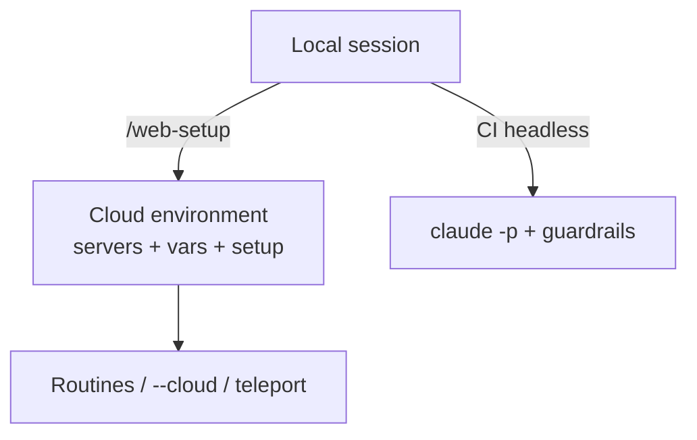

# FAQ 10 — CI, SDK, routines, web

> **Bài này cho ai:** bạn cần dùng Claude Code trong CI, đẩy task lên cloud, chạy routines định kỳ, hay nhúng SDK vào quy trình tự động.
> **Cần gì trước:** đã đọc [FAQ 01 — tài khoản, pricing & cài đặt](01-tai-khoan-pricing-cai-dat.md); biết `claude login` / `claude -p`.
> **Đọc xong bạn làm được:** chạy Claude trong CI an toàn (allowlist hẹp + secrets từ env); dùng `Setup` hook đúng flag; tạo routines + cloud session + `/teleport`; biết khi nào cần Agent SDK / `claude mcp serve`; checklist trước khi bật automation.
> **Thời gian:** ~15 phút

## Thuật ngữ dùng trong bài này

| Thuật ngữ | Hiểu nôm na là gì | Ví dụ thấy ngay |
|---|---|---|
| CI (continuous integration) | Tự động chạy kiểm tra/build khi code thay đổi | GitHub Actions chạy `claude -p` review PR |
| SDK (software development kit) | Bộ API để nhúng Claude vào app riêng | Agent SDK viết bot nội bộ |
| routines | Nhiệm vụ chạy định kỳ trên cloud Anthropic | `/schedule` chạy digest 8h sáng |
| web/cloud | Mặt web/cloud của Claude (cần sign-in claude.ai) | `/web-setup`, `claude --cloud`, `/teleport` |
| headless | Chạy không cần tương tác người dùng | `claude -p "ping"` trong CI |
| allowlist | Danh sách tool được phép dùng, giới hạn tối đa | `--allowedTools "Read Grep Glob"` |
| dontAsk | Chạy tự động, không hỏi xác nhận | `--permission-mode dontAsk` |
| Setup hook | Hook chạy 1 lần chuẩn bị môi trường trước task | `--init` / `--init-only` / `--maintenance` |
| teleport | Chuyển session giữa terminal ↔ cloud | `/teleport` tiếp tục task dở |
| MCP | Giao thức kết nối tool ngoài | `claude mcp serve` biến Claude thành MCP server |

## Mục lục

- [Sơ đồ nhanh](#sơ-đồ-nhanh)
- [Bảng tổng hợp: chọn đường automation nào?](#bảng-tổng-hợp-chọn-đường-automation-nào)
- [1. Dùng Claude trong CI thế nào mà vẫn an toàn? (pattern + YAML)](#1-dùng-claude-trong-ci-thế-nào-mà-vẫn-an-toàn-pattern--yaml)
- [2. `Setup` hook event để làm gì?](#2-setup-hook-event-để-làm-gì)
- [3. Routines (`/schedule`) là gì?](#3-routines-schedule-là-gì)
- [4. Cloud session từ terminal + `/teleport`?](#4-cloud-session-từ-terminal--teleport)
- [5. Agent SDK khi nào? `claude mcp serve` là gì?](#5-agent-sdk-khi-nào--claude-mcp-serve-là-gì)
- [6. Analytics cho team?](#6-analytics-cho-team)
- [7. CI YAML hoàn chỉnh + checklist trước khi bật automation?](#7-ci-yaml-hoàn-chỉnh--checklist-trước-khi-bật-automation)
- [Vẫn lỗi thì sao? (CI/SDK/web)](#vẫn-lỗi-thì-sao-cisdkweb)

---

## Sơ đồ nhanh



## Bảng tổng hợp: chọn đường automation nào?

| Đường | Chạy ở đâu | Cần gì | Dùng khi nào |
|---|---|---|---|
| `claude -p` CI (dontAsk + allowlist) | Runner CI | Sub/Console/Bedrock/AWS/GCP (Foundry ✗) | Review, migrate, triage tự động |
| `Setup` hook event | CI/scripts 1 lần | `--init-only` / `--init` / `--maintenance` | Chuẩn bị môi trường trước task |
| Routines (`/schedule`) | Cloud Anthropic | Subscription (sign-in claude.ai) | Digest sáng, dep audit, docs sync |
| `claude --cloud` + `/web-setup` | Cloud | `gh` CLI + environment | Task nặng, không muốn chạy local |
| Teleport (`/teleport`) | Terminal ↔ cloud | Subscription, sessions persist | Đổi máy giữa chừng |
| Agent SDK | App của bạn | Build agent riêng (tools+permissions+orchestration) | Quy trình đặc thù / UI riêng / nhúng internal |
| `claude mcp serve` | Máy bạn (stdio) | Expose Claude thành MCP server | Hệ khác gọi Claude như tool |
| Analytics (`/insights`, dashboard) | Team/Enterprise | Plan tương ứng | Đo habits, contribution theo plan |

---

## 1. Dùng Claude trong CI thế nào mà vẫn an toàn? (pattern + YAML)

> **Hỏi ngắn gọn:** dùng Claude trong CI thế nào mà vẫn an toàn?
> **Trả lời 1 câu:** Pattern an toàn 5 điểm: `-p` + `--output-format json` + `--permission-mode dontAsk` + `--allowedTools` hẹp + secrets từ runner env.

Provider hỗ trợ CI headless gồm Sub/Console/Bedrock/AWS/GCP — **Foundry ✗**. Không dùng `--dangerously-skip-permissions` ngoài sandbox; đọc secrets từ environment runner, không hardcode.

```bash
claude -p "review diff origin/main...HEAD, chỉ báo security + sai logic, bỏ style. Trả JSON." \
  --output-format json \
  --permission-mode dontAsk \
  --allowedTools "Read Grep Glob Bash(git diff:*) Bash(git log:*) Bash(npm test:*)"
```

**YAML ví dụ (GitHub Actions — review PR):**

```yaml
name: claude-review
on: [pull_request]
jobs:
  review:
    runs-on: ubuntu-latest
    steps:
      - uses: actions/checkout@v4
        with: { fetch-depth: 0 }
      - run: curl -fsSL https://claude.ai/install.sh | bash
      - run: >
          claude -p "Review diff origin/main...HEAD, chỉ báo security + sai logic, bỏ qua style. Trả JSON."
          --output-format json
          --permission-mode dontAsk
          --allowedTools "Read Grep Glob Bash(git diff:*) Bash(git log:*)"
          > review.json
        env:
          ANTHROPIC_API_KEY: ${{ secrets.ANTHROPIC_API_KEY }}
      - run: python3 -c "import json; print(json.load(open('review.json'))['result'])"
```

Test nhanh: `claude -p "ping" --output-format json --permission-mode dontAsk --allowedTools "Read"` → JSON trả về ping, exit 0.

**Đào sâu:** [FAQ 01 — tài khoản & provider](01-tai-khoan-pricing-cai-dat.md) · [FAQ 03 — permissions & modes](03-permissions-modes.md) · [FAQ 09 — bảo mật](09-bao-mat-quyen-rieng-tu.md)

## 2. `Setup` hook event để làm gì?

> **Hỏi ngắn gọn:** `Setup` hook event để làm gì?
> **Trả lời 1 câu:** `Setup` chạy 1 lần chuẩn bị môi trường cho CI/scripts — trước cả task chính.

| Flag | Việc | Dùng khi nào |
|---|---|---|
| `--init-only` | Chỉ chạy Setup rồi thoát (không làm task) | Warm cache, check env trước giờ G |
| `--init` | Chạy Setup rồi làm task luôn | CI job chuẩn |
| `--maintenance` | Bảo trì (dọn cache, update index...) | Cron đêm |

```bash
# CI job chuẩn: setup rồi review
claude -p "review diff" --init --output-format json --permission-mode dontAsk \
  --allowedTools "Read Grep Glob Bash(git diff:*)"

# Warm env đêm trước (không tốn task):
claude -p "" --init-only
```

**Đào sâu:** [FAQ 05 — hooks](05-hooks-faq.md) · [FAQ 08 — lỗi thường gặp](08-loi-thuong-gap-troubleshooting.md)

## 3. Routines (`/schedule`) là gì?

> **Hỏi ngắn gọn:** Routines (`/schedule`) là gì?
> **Trả lời 1 câu:** Routines = task chạy định kỳ / gọi API / GitHub-event **trên cloud** (cần subscription, không API-key-only): morning digest, dep audit, docs sync.

Viết prompt như skill và gắn verify, nếu không nó "xong" mà không ai kiểm.

```bash
/schedule
# → tạo: morning digest 8h (tóm tắt PRs + CI đỏ + issues mới)
# → tạo: dep audit thứ 2 (list outdated + CVE, mở PR nếu patch)
# → tạo: docs sync (diff code vs docs, báo lệch)
```

```text
Mỗi sáng 8h: tóm tắt PRs mở + CI đỏ + issues mới (repo X).
Verify: mỗi mục kèm link. Không tự merge. Gửi digest về Slack #dev.
```

**Đào sâu:** [FAQ 01 — tài khoản](01-tai-khoan-pricing-cai-dat.md) · [FAQ 09 — bảo mật](09-bao-mat-quyen-rieng-tu.md)

## 4. Cloud session từ terminal + `/teleport`?

> **Hỏi ngắn gọn:** bắt đầu cloud session từ terminal thế nào, chuyển session giữa 2 nơi ra sao?
> **Trả lời 1 câu:** `/web-setup` (cần `gh` CLI: sync token, tạo environment) rồi `claude --cloud "<task>"`; `/teleport` chuyển session đang làm dở giữa terminal ↔ cloud (sessions persist cross-device).

Cloud environment lưu servers/env vars/setup script dùng chung. Mode cloud: **Accept edits** (tự sửa + push branch) / **Plan** (chờ duyệt) — không có Bypass. VD: laptop yếu, task nặng (migrate 30 files) → đẩy lên cloud Accept edits, xong về check PR.

```bash
# 1. Chuẩn bị (1 lần/repo):
/web-setup
# → sync token qua gh, khai MCP servers + env vars + setup script cho cloud

# 2. Chạy:
claude --cloud "migrate endpoint X sang v2, mở PR"

# 3. Chuyển nơi làm việc:
/teleport
# → terminal đang 30 turns → lên cloud chạy tests nặng qua đêm → sáng resume
```

**Đào sâu:** [Bài 02 — các bề mặt: terminal/IDE/web/desktop](../01-huong-dan-su-dung/02-cac-be-mat-terminal-ide-web-desktop.md) · [lệnh `teleport`](../01-huong-dan-su-dung/commands/auth-settings/teleport/README.md) · [FAQ 03 — permissions & modes](03-permissions-modes.md)

<!-- CHUNK2 -->

---

## 5. Agent SDK khi nào? `claude mcp serve` là gì?

> **Hỏi ngắn gọn:** khi nào cần Agent SDK, `claude mcp serve` để làm gì?
> **Trả lời 1 câu:** Mặc định Claude Code đã đủ — chỉ build SDK khi quy trình quá đặc thù (pipeline/UI riêng, bot internal); `claude mcp serve` đảo vai: expose Claude thành 1 MCP stdio server cho hệ khác gọi.

Automation đơn giản → `claude -p` trong CI là đủ (câu 1), không cần SDK. Khi build SDK: thu hẹp scope bằng `setting_sources` để không load hết config user.

```python
# pseudocode — đọc SDK docs cho API thật
agent = ClaudeAgent(
    tools=["Read", "Grep", "Glob"],       # hẹp nhất có thể
    permissions={...},                     # allowlist rõ
    setting_sources=["project"],           # chỉ .claude/, không ~/.claude/
)
result = agent.run("triage ticket X")
```

```bash
# Chiều ngược: hệ khác (IDE lạ, bot Slack nội bộ) gọi Claude như tool
claude mcp serve --transport stdio
# → hệ khác add như 1 MCP server stdio bình thường
```

**Đào sâu:** [Bài 12 — Agent SDK, CI/CD](../01-huong-dan-su-dung/12-agent-sdk-ci-cd-automation.md) · [FAQ 04 — MCP](04-mcp-faq.md) · [lệnh `mcp-serve`](../01-huong-dan-su-dung/commands/knowledge-system/mcp-serve/README.md)

---

## 6. Analytics cho team?

> **Hỏi ngắn gọn:** đo lường usage cho team thế nào?
> **Trả lời 1 câu:** Đo theo plan (càng cao càng sâu): `/stats` → `/insights` → Dashboard → Enterprise Analytics API.

| Công cụ | Ra gì | Plan |
|---|---|---|
| `/stats` | Token/tiền cá nhân | Mọi plan |
| `/insights` | HTML habits (giờ nào tốn, skill nào dùng) | Sub+ |
| Dashboard | Contribution metrics team | Team/Enterprise |
| Enterprise Analytics API | Pull metrics về BI nội bộ | Enterprise |
| Server-managed settings / SSO / SCIM | Quản lý tập trung | Theo plan ([FAQ 01](01-tai-khoan-pricing-cai-dat.md)) |

```bash
/stats        # tôi tốn bao nhiêu
/insights     # thói quen team (HTML) — cuối sprint chạy 1 lần
/extra-usage  # usage vượt gói?
```

**Đào sâu:** [lệnh `insights`](../01-huong-dan-su-dung/commands/knowledge-system/insights/README.md) · [lệnh `stats`](../01-huong-dan-su-dung/commands/knowledge-system/stats/README.md) · [FAQ 09 — bảo mật](09-bao-mat-quyen-rieng-tu.md)

---

## 7. CI YAML hoàn chỉnh + checklist trước khi bật automation?

> **Hỏi ngắn gọn:** CI YAML hoàn chỉnh trông thế nào, bật automation mới cần kiểm gì?
> **Trả lời 1 câu:** Workflow 3 jobs rẻ-trước-đắt-sau (secret-check → doctor-gate → review); trước khi bật: allowlist hẹp, secrets từ env, chạy tay 1 lần xanh, headless-safe, verify đã gắn.

**YAML hoàn chỉnh** (thứ tự rẻ-trước-đắt-sau để fail nhanh; hợp team ≥3 người):

```yaml
name: claude-ci
on: [pull_request]
jobs:
  secrets:
    runs-on: ubuntu-latest
    steps:
      - uses: actions/checkout@v4
      - run: git grep -E 'ghp_|sk-ant_|xoxb-|AKIA' -- .mcp.json .claude/ . && exit 1 || echo "secrets clean"
  doctor-gate:
    runs-on: ubuntu-latest
    needs: secrets
    steps:
      - uses: actions/checkout@v4
      - run: curl -fsSL https://claude.ai/install.sh | bash
      - run: claude /doctor --json > doctor.json
        env: { ANTHROPIC_API_KEY: ${{ secrets.ANTHROPIC_API_KEY }} }
      - run: python3 -c "import json,sys; d=json.load(open('doctor.json')); print(d['score']); sys.exit(1 if d['score']<70 else 0)"
  review:
    runs-on: ubuntu-latest
    needs: doctor-gate
    steps:
      - uses: actions/checkout@v4
        with: { fetch-depth: 0 }
      - run: curl -fsSL https://claude.ai/install.sh | bash
      - run: >
          claude -p "Review diff, chỉ security + sai logic."
          --output-format json --permission-mode dontAsk
          --allowedTools "Read Grep Glob Bash(git diff:*)" > review.json
        env: { ANTHROPIC_API_KEY: ${{ secrets.ANTHROPIC_API_KEY }} }
```

**Checklist 5 mục trước khi schedule/bật automation:**

```bash
# 1. Allowlist hẹp? (không bypass ngoài sandbox)
/permissions
# 2. Secrets từ env? (git grep rỗng?)
git grep -E 'ghp_|sk-ant_' -- .mcp.json .claude/ .
# 3. Chạy tay 1 lần xanh với đúng flags CI?
claude -p "<task>" --output-format json --permission-mode dontAsk --allowedTools "Read Grep Glob ..."
# 4. Headless-safe? (hooks không prompt)
/hooks
# 5. Verify gắn chưa? (ai check output? tests? human?)
/verify
```

**Đào sâu:** [lệnh `doctor`](../01-huong-dan-su-dung/commands/knowledge-system/doctor/README.md) · [FAQ 08 — lỗi thường gặp](08-loi-thuong-gap-troubleshooting.md) · [FAQ 05 — hooks](05-hooks-faq.md)

---

## Vẫn lỗi thì sao? (CI/SDK/web)

1. CI deny → allowlist hẹp-đúng + `dontAsk` (câu 1), không bypass.
2. Cloud thiếu đồ → `/web-setup` lại environment ([FAQ 04](04-mcp-faq.md)).
3. Version lệnh lạ → `/status` + `claude update` ([FAQ 01 câu 5](01-tai-khoan-pricing-cai-dat.md#5-claude-update-và-version-floor-lệnh-lạ-90-là-version-cũ)).
4. Rate/provider → `/usage` + đổi key (Foundry không hỗ trợ `-p`).
5. `/debug` → chẩn đoán; `/bug` kèm `/status` + `doctor`.

```bash
claude -p "ping" --output-format json --permission-mode dontAsk --allowedTools "Read"
```

---

**Tham khảo chéo:** [Bài 12 — Agent SDK, CI/CD automation](../01-huong-dan-su-dung/12-agent-sdk-ci-cd-automation.md) · [Bài 02 — các bề mặt](../01-huong-dan-su-dung/02-cac-be-mat-terminal-ide-web-desktop.md) · [Bài tips 09 — teamwork chuẩn hóa](../02-tips-thuc-chien/09-teamwork-chuan-hoa.md) · [FAQ 01](01-tai-khoan-pricing-cai-dat.md) (provider) · [FAQ 03](03-permissions-modes.md) (headless) · [FAQ 04](04-mcp-faq.md) (MCP) · [FAQ 09](09-bao-mat-quyen-rieng-tu.md) (CI an toàn)

> Mẹo 1 dòng: _CI thì dontAsk + allowlist hẹp + secrets từ env — và automation nào cũng phải có verify._
